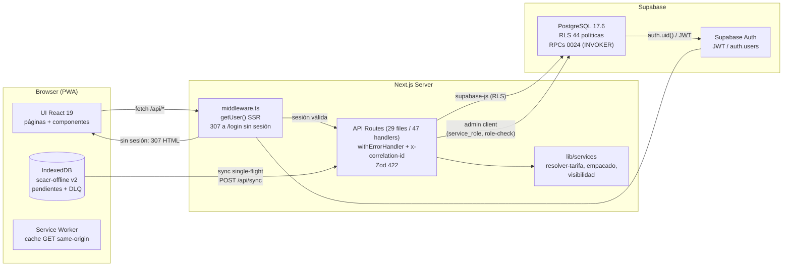
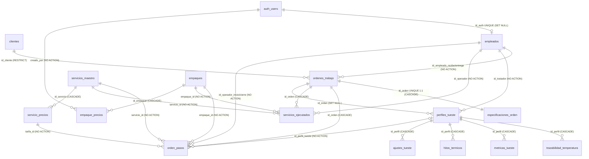
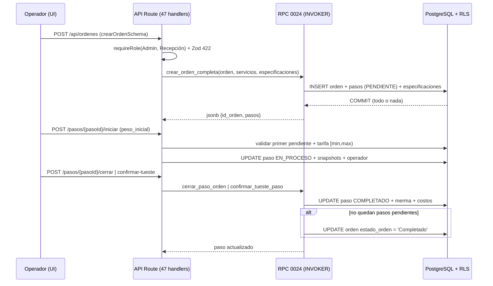
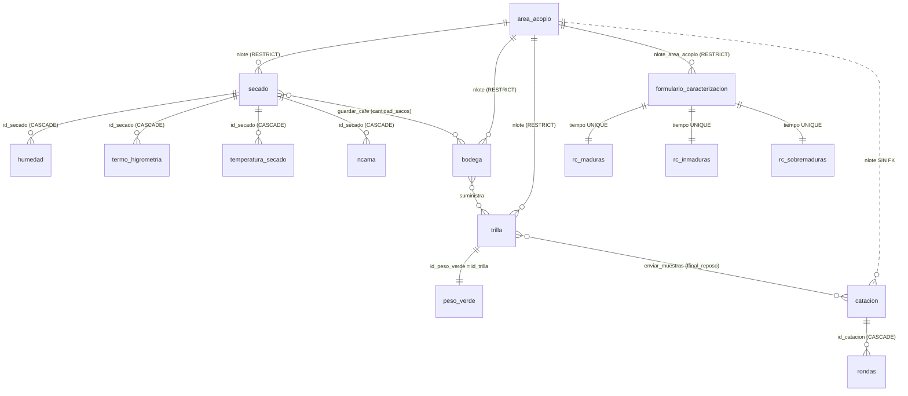
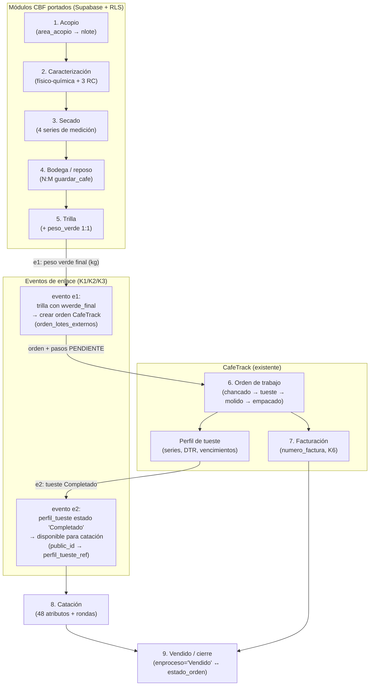

# Arquitectura y Datos — CafeTrack (SCACR) y base estructural para la fusión con CoffeeBeanFlow

> **Propósito**: documento autosuficiente de referencia técnica que (1) cataloga con evidencia verificada el estado actual de CafeTrack/SCACR (esquema de base de datos, RLS, API, lógica de negocio) y (2) define la base estructural para **fusionar** los módulos de **CoffeeBeanFlow (CBF)** — acopio, caracterización, secado, bodega, trilla y catación — dentro de CafeTrack.
>
> **Decisión de diseño tomada (no renegociable)**: **FUSIÓN de módulos en CafeTrack**. Los módulos de CBF se portan al stack de CafeTrack (Next.js + Supabase). Las alternativas cross-system (API dedicada, vistas de lectura, outbox/webhook) se mencionan únicamente en el **Apéndice G** como contingencia; **no** son el plan principal.
>
> **Metodología**: las 24 migraciones (`0001`–`0025`, no existe `0008`) fueron aplicadas sobre un PostgreSQL 17 limpio y el esquema final se leyó del catálogo del sistema (`pg_constraint`, `pg_policies`, `pg_proc`, `pg_indexes`, `information_schema`), contrastado después con producción para anotar drift (ninguno relevante). El código (`29 archivos route.ts`, `lib/**`) se verificó directamente. Detalle de la metodología y evidencia bruta en `specs/001-doc-arquitectura-integracion/research.md`.
>
> **Regla de evidencia**: todo dato cita su migración o `archivo:línea`. Lo no verificable en repo o en la spec CBF se marca **(hipótesis)** o **(confirmar con responsable)**. Los conteos donde la realidad difiere del plan original se declaran explícitamente (§ deltas).
>
> **Fecha**: 2026-11-04 · **Feature spec**: `specs/001-doc-arquitectura-integracion/`

---

## Índice

1. [Visión General y Stack](#1-visión-general-y-stack)
2. [Base de Datos (CRÍTICO)](#2-base-de-datos-crítico)
3. [Lógica de Negocio](#3-lógica-de-negocio)
4. [Matriz de Integración (Crossover)](#4-matriz-de-integración-crossover)
5. [Anexos](#5-anexos)

---

# 1. Visión General y Stack

## 1.1 Propósito del sistema

SCACR (Sistema de Administración de Café) gestiona el negocio de torrefacción del Centro Agrícola Cantonal de Desamparados: órdenes de trabajo de clientes, servicios del maestro (chancado, trillado, clasificación, tueste, molido, empacado) con tarifas por intervalo de peso, perfiles de tueste con trazabilidad térmica por minuto, y facturación. La app es una **PWA con resiliencia offline** (IndexedDB + cola de sincronización con dead-letter queue).

La contraparte **CoffeeBeanFlow** cubre las etapas **previas** del café: acopio del lote, caracterización físico-química, secado, bodega/reposo, trilla y catación sensorial. La fusión propuesta conecta ambos extremos en un pipeline unificado (§4.7).

## 1.2 Stack tecnológico (versiones exactas verificadas en `package.json`)

| Capa | Tecnología | Versión | Notas |
|---|---|---|---|
| Framework | Next.js (App Router) | 16.2.10 | Turbopack; puerto dev 3016 |
| UI | React | 19.2.4 | Server/Client Components |
| Estilo | Tailwind CSS | v4 | + componentes shadcn/ui |
| Formularios | react-hook-form + `@hookform/resolvers` | — | con `zodResolver` |
| Validación | Zod | v4 | en frontend, API y (contraparte) sync offline |
| DB/Auth | Supabase (PostgreSQL 17.6 + Auth) | `@supabase/ssr` 0.12.0 | RLS + roles en tabla `empleados` |
| Offline | IndexedDB vía `idb` | v8 | DB `scacr-offline` v2; sin Dexie |
| Estado servidor | — | — | TanStack Query instalado pero **sin adoptar** (sin QueryClient en el código) |
| Tests | Vitest (+ jsdom, `fake-indexeddb`) | 4.x | 17 suites / 160 tests |
| PWA | Service Worker | — | cache de GET same-origin (ver A1, §4.8) |
| PDF | html-to-image + jspdf | — | recibo de orden |

## 1.3 Diagrama de capas (C4-lite, contenedores)

**Fila de contexto de borde** (verificado en `middleware.ts:6-53` y rutas):

| Aspecto | Comportamiento real |
|---|---|
| Autenticación de API | `middleware.ts` redirige `/api/*` (excepto `/api/auth`) a `/login` con **307 HTML** si no hay sesión — **no hay 401 JSON desde el middleware**; los handlers además validan con `requireAuth()/requireRole()` (`lib/api-helpers.ts:101-153`) |
| CORS | Sin CORS configurado: todo es **same-origin** (no hay integraciones externas hoy) |
| Eventos | Sin webhooks ni Supabase Realtime consumido |
| Cookies | Reescritas por `lib/cookies.ts` preservando `httpOnly` upstream; `Cache-Control: private, no-store` en middleware |

---

## 1.4 Actores y roles

| Actor | Rol en `empleados` | Alcance operativo (según RLS/API verificadas) |
|---|---|---|
| Administración | `Admin` | Todo: catálogo maestro (servicios, intervalos, empaques, precios), empleados, zonas, órdenes y tuestes; DELETE lógicos |
| Recepción | `Recepción` | Clientes, órdenes nuevas, especificaciones, servicios ejecutados (legacy), iniciar/cerrar pasos generales |
| Tostador | `Tostador` | Perfiles de tueste y series (temperaturas/hitos/métricas/ajustes), iniciar/cerrar pasos incluyendo confirmación de tueste |
| Operador | `Operador` | Definido en el enum pero **sin políticas dedicadas** — hoy sin acceso operativo por API (solo `empleados_lectura_propia`) |
| Cliente | — (fuera del sistema) | No tiene cuenta; firma física (`firma_aprobacion_cliente`) |

En la fusión, CBF introduce actos de **Recepción de finca** (acopio) naturalmente mapeables al rol `Recepción`, y la **catación** al rol `Tostador` (quien conoce el tueste) o a un rol nuevo `Catador` (decisión de detalle — confirmar con responsable).

## 1.5 Glosario mínimo de dominio

| Término | Significado operativo | Verificable en |
|---|---|---|
| Lote de café | Volumen recibido de un productor en una fecha (CBF `nlote`) | CBF §2.1 |
| Lote de tueste | Identificador `VARCHAR(20)` de la hornada de tueste (`perfiles_tueste.numero_lote`) — **no es el lote de café** | `0001` |
| DTR | Development Time Ratio — ratio de desarrollo del tueste, recalculado por trigger al cambiar hitos | `0001`, `trg_hitos_dtr` |
| Zaranda | Tamiz de granulometría (13–20) en catación | CBF §2.15 |
| Agtron | Tonalidad del tueste medida en 8 niveles (25–95) | CBF §2.15 |
| Beche | **Bache (batch) de tostadora** — denominación local de la planta para la hornada de un tueste; confirma al responsable que NO es el lote de café verde (decisión 2026-11-06). 0 apariciones del término en CBF y CafeTrack (verificado por grep). *(Por confirmar con la planta: redacción exacta del término local, quién lo asigna y el formato)* | Responsable de planta |
| Peso facturable | Peso con el que se cobra un paso (`orden_pasos.peso_facturable_kg`, `0022`) | `0022` |
| Merma | `peso_inicial − peso_final` (kg y %) | RPC `0024`, `lib/services/resolver-tarifa.ts` |

# 2. Base de Datos (CRÍTICO)

> Fuente de verdad: catálogo de PostgreSQL tras aplicar las 24 migraciones (PostgreSQL 17.10 limpio, stubs de `auth`); drift vs producción 17.6: **ninguno** en políticas/índices/privilegios.

## 2.1 Diagrama ER (16 tablas, cardinalidades y ON DELETE reales)

Notas de modelado: `especificaciones_orden` es **1:1** con la orden (UNIQUE `id_orden`, `0001`). `orden_pasos.id_perfil_tueste` existe con FK pero **el código actual nunca la escribe** (§3, I4) — la relación tueste↔paso se establece vía `perfiles_tueste.id_orden`. Todas las PK son `serial` (INTEGER IDENTITY implícito); los IDs son **locales** y reasignables entre entornos (motiva K2, §4.3).

## 2.2 Catálogo columna a columna (16 tablas)

Leyenda: **PK**/**FK**/**U** = primary key/foreign key/unique; *Migr.* = migración que creó/modificó la columna. Los tipos `numeric` de pesos son `NUMERIC(10,2)` salvo indicación.

### `clientes` (0001; soft-delete 0011)

| Columna | Tipo | Nulo | Default | Constraints / Notas | Migr. |
|---|---|---|---|---|---|
| `id_cliente` | serial | NO | auto | **PK** | 0001 |
| `nombre_completo` | varchar | NO | — | índices btree + trgm (0023) | 0001 |
| `telefono` | varchar | SÍ | — | índice `idx_clientes_telefono` (0023) | 0001 |
| `zona_procedencia` | varchar | SÍ | — | texto libre (sin FK a zonas_finca) | 0001 |
| `fecha_registro` | timestamptz | NO | `now()` | | 0001 |
| `deleted_at` | timestamptz | SÍ | — | soft-delete; RLS SELECT filtra `IS NULL` | 0011 |

### `empleados` (0001; RLS 0007/0012)

| Columna | Tipo | Nulo | Default | Constraints / Notas | Migr. |
|---|---|---|---|---|---|
| `id_empleado` | serial | NO | auto | **PK** | 0001 |
| `nombre` | varchar | NO | — | índice parcial activos (0023) | 0001 |
| `rol` | `rol_empleado_enum` | NO | — | 'Operador','Tostador','Recepción','Admin' | 0001 |
| `id_auth` | uuid | SÍ | — | **U** → `auth.users(id)` **ON DELETE SET NULL**; UNIQUE (join con Auth) | 0001 |
| `activo` | boolean | NO | `true` | baja lógica (no usa `deleted_at`) | 0001 |
| `created_at` | timestamptz | NO | `now()` | | 0001 |

> ⚠️ `docs/DB_SCHEMA.md` atribuye `deleted_at` a `empleados`: **incorrecto** (la tabla usa `activo`). Anexo F.

### `ordenes_trabajo` (0001; 0004, 0005→0009, 0010, 0011, 0012)

| Columna | Tipo | Nulo | Default | Constraints / Notas | Migr. |
|---|---|---|---|---|---|
| `id_orden` | serial | NO | auto | **PK** | 0001 |
| `id_cliente` | int | NO | — | **FK** → clientes **RESTRICT** | 0001 |
| `porcentaje_humedad_entrada` | numeric | SÍ | — | CHECK 0–100 | 0001 |
| `proceso_cafe` | `proceso_cafe_enum` | SÍ | — | 'Lavado','Honey','Natural','Otro'; nullable desde 0004 (antes NOT NULL DEFAULT 'Otro') | 0001/0004 |
| `descripcion_producto` | text | SÍ | — | | 0001 |
| `id_empleado_recibe` | int | SÍ | — | FK → empleados, NO ACTION | 0001 |
| `id_empleado_entrega` | int | SÍ | — | FK → empleados, NO ACTION | 0001 |
| `fecha_orden` | date | NO | **CURRENT_DATE** | ⚠️ UTC en DB (desafío T6) | 0001 |
| `estado_orden` | `estado_orden_enum` | NO | `'Pendiente'` | 'Pendiente','En Proceso','Completado','Cancelado' | 0001 |
| `firma_aprobacion_cliente` | boolean | NO | `false` | | 0001 |
| `fecha_aprobacion` | date | SÍ | — | | 0001 |
| `created_at` / `updated_at` | timestamptz | NO | `now()` | trigger `trg_ordenes_updated_at` | 0001 |
| `zona_finca` | varchar | SÍ | — | texto libre (sin FK) | 0003 |
| `hora_cierre` | time | SÍ | — | | 0004 |
| `numero_factura` | varchar(20) | NO | — | **U** `ordenes_numero_factura_unique`; generada por trigger `trg_numero_factura_auto`/`generar_numero_factura()` | 0009 |
| `deleted_at` | timestamptz | SÍ | — | soft-delete | 0011 |

Historial de columnas caídas (posición 2 y 4): `num_talonario_fisico VARCHAR(20) UNIQUE` y `num_factura VARCHAR(30)` existieron en `0001` y fueron **dropeadas en `0009`** (consolidación en `numero_factura`; la secuencia `talonario_seq` iniciada en 454 por `0005` también fue eliminada).

### `servicios_ejecutados` (0001; 0010, 0017, 0018) — **LEGACY parcial** (T13)

| Columna | Tipo | Nulo | Default | Constraints / Notas | Migr. |
|---|---|---|---|---|---|
| `id_servicio` | serial | NO | auto | **PK** | 0001 |
| `id_orden` | int | NO | — | FK → ordenes_trabajo CASCADE | 0001 |
| `tipo_servicio` | **text** | NO | — | era `tipo_servicio_enum` (0001); **pasó a text en `0017`** (huérfano desde entonces) | 0017 |
| `peso_inicial` | numeric | SÍ | — | legado | 0001 |
| `precio` | numeric | SÍ | — | legado | 0001 |
| `fecha_hora` | timestamptz | SÍ | — | | 0001 |
| `id_operador` | int | SÍ | — | FK → empleados | 0001 |
| `servicio_id` | int | SÍ | — | FK → servicios_maestro (NO ACTION) | 0017 |
| `empaque_id` | int | SÍ | — | FK → empaques (NO ACTION); índice (0023) | 0017 |
| `peso_kg` | numeric | SÍ | — | | 0017 |
| `snapshot_precio_por_kg` | numeric | SÍ | — | snapshot de tarifa | 0017 |
| `snapshot_precio_empaque` | numeric | SÍ | — | | 0017 |
| `linea_total` | numeric | SÍ | — | `peso_kg × precio_por_kg + precio_empaque` | 0017 |
| `override_precio` | boolean | NO | `false` | | 0017 |
| `override_motivo` | text | SÍ | — | auditoría de override | 0017 |

Constraints: **U** `(id_orden, tipo_servicio, empaque_id)` (0010; reformulada en 0017/0018 para permitir mismo servicio con distinto empaque). Estado: tabla **legacy** — no integrable directamente con `orden_pasos`; plan de retiro E1–E5 en `docs/LEGACY_MIGRATION_PLAN.md` (T13).

### `especificaciones_orden` (0001) — 1:1 con la orden

| Columna | Tipo | Nulo | Default | Constraints / Notas | Migr. |
|---|---|---|---|---|---|
| `id_especificacion` | serial | NO | auto | **PK** | 0001 |
| `id_orden` | int | NO | — | FK → ordenes_trabajo CASCADE; **UNIQUE** (1:1) | 0001 |
| `tipo_tueste` | varchar(100) | SÍ | — | texto libre — los enums de `0002` **nunca se aplicaron** a estas columnas | 0001 |
| `tipo_molienda` | varchar(100) | SÍ | — | ídem | 0001 |
| `tipo_empaque` | varchar(100) | SÍ | — | ídem | 0001 |
| `especificacion_extra` | text | SÍ | — | | 0001 |
| `observaciones` | text | SÍ | — | | 0001 |

### `perfiles_tueste` (0001; 0013, 0022)

| Columna | Tipo | Nulo | Default | Constraints / Notas | Migr. |
|---|---|---|---|---|---|
| `id_perfil` | serial | NO | auto | **PK** | 0001 |
| `id_orden` | int | SÍ | — | FK → ordenes_trabajo **SET NULL**; índices (0023) | 0001 |
| `numero_lote` | varchar(20) | SÍ | — | identificador de lote de tueste; **sin FK, sin UNIQUE** (solo índice no-único `idx_perfiles_lote`, 0023) — ⚠️ **no es** el lote de café de CBF (FR-010) | 0001 |
| `fecha_tueste` | date | NO | **CURRENT_DATE** | ⚠️ UTC (T6) | 0001 |
| `id_tostador` | int | SÍ | — | FK → empleados | 0001 |
| `nombre_cafe` | varchar | SÍ | — | | 0001 |
| `temperatura_sala` | numeric | SÍ | — | | 0001 |
| `humedad_sala` | numeric | SÍ | — | | 0001 |
| `tiempo_desarrollo_min` | numeric | SÍ | — | | 0001 |
| `dtr_porcentaje` | numeric | SÍ | — | DTR calculado por `trg_hitos_dtr`/`calc_dtr_perfil` | 0001 |
| `fecha_optima_consumo` | date | SÍ | — | calculada por `calc_fechas_trazabilidad` | 0001 |
| `fecha_vencimiento` | date | SÍ | — | ídem | 0001 |
| `created_at` / `updated_at` | timestamptz | NO | `now()` | triggers `trg_perfiles_fechas` + `update_updated_at` | 0001 |
| `deleted_at` | timestamptz | SÍ | — | soft-delete | 0011 |
| `estado` | varchar(20) | NO | `'Pendiente'` | **sin CHECK en DB**; la API restringe a 'Pendiente'/'Completado' vía Zod | 0013 |

### `trazabilidad_temperatura` (0001; 0015)

| Columna | Tipo | Nulo | Default | Constraints / Notas | Migr. |
|---|---|---|---|---|---|
| `id_registro` | serial | NO | auto | **PK** | 0001 |
| `id_perfil` | int | NO | — | FK → perfiles_tueste CASCADE | 0001 |
| `minuto` | **numeric(5,2)** | NO | — | CHECK ≥ 0; **UNIQUE (id_perfil, minuto)**; era SMALLINT, migrado a NUMERIC en 0015 (granularidad sub-minuto); índice (0023) | 0001/0015 |
| `temperatura_registrada` | numeric | SÍ | — | **CHECK 70–220 °C** | 0001 |

### `metricas_tueste` (0001)

| Columna | Tipo | Nulo | Default | Constraints / Notas | Migr. |
|---|---|---|---|---|---|
| `id_metrica` | serial | NO | auto | **PK** | 0001 |
| `id_perfil` | int | NO | — | FK → perfiles_tueste CASCADE | 0001 |
| `tipo_metrica` | `tipo_metrica_enum` | NO | — | 'Peso','Humedad','Densidad'; **U** (id_perfil, tipo_metrica) | 0001 |
| `valor_antes` | numeric | SÍ | — | | 0001 |
| `valor_despues` | numeric | SÍ | — | | 0001 |
| `porcentaje_diferencia` | numeric | SÍ | — | calculada por `trg_metricas_diferencia`/`calc_porcentaje_diferencia` | 0001 |

### `hitos_termicos` (0001)

| Columna | Tipo | Nulo | Default | Constraints / Notas | Migr. |
|---|---|---|---|---|---|
| `id_hito` | serial | NO | auto | **PK** | 0001 |
| `id_perfil` | int | NO | — | FK → perfiles_tueste CASCADE | 0001 |
| `tipo_hito` | `tipo_hito_enum` | NO | — | 8 valores ('Turning Point'…'Tiempo Enfriamiento'); **U** (id_perfil, tipo_hito) | 0001 |
| `tiempo_min` | numeric | SÍ | — | | 0001 |
| `temperatura` | numeric | SÍ | — | | 0001 |

### `ajustes_tueste` (0001)

| Columna | Tipo | Nulo | Default | Constraints / Notas | Migr. |
|---|---|---|---|---|---|
| `id_ajuste` | serial | NO | auto | **PK** | 0001 |
| `id_perfil` | int | NO | — | FK → perfiles_tueste CASCADE | 0001 |
| `orden_secuencia` | smallint | NO | — | **U** (id_perfil, orden_secuencia) | 0001 |
| `temperatura_ajuste` | numeric | SÍ | — | | 0001 |
| `llama` | varchar | SÍ | — | control del quemador | 0001 |
| `tiempo` | numeric | SÍ | — | | 0001 |
| `aire` | varchar | SÍ | — | control de aire | 0001 |
| `fecha_hora_ajuste` | timestamptz | NO | `now()` | | 0001 |

### `servicios_maestro` (0017; 0019, 0021)

| Columna | Tipo | Nulo | Default | Constraints / Notas | Migr. |
|---|---|---|---|---|---|
| `id_servicio_maestro` | serial | NO | auto | **PK** | 0017 |
| `nombre` | varchar(150) | NO | — | | 0017 |
| `descripcion` | text | SÍ | — | limpiar requiere clave explícita en RPC (§4.6, T-lista) | 0017 |
| `activo` | boolean | NO | `true` | baja lógica | 0017 |
| `created_at` / `updated_at` | timestamptz | NO | `now()` | trigger `update_updated_at` | 0017 |
| `prioridad` | int | NO | — | **sin UNIQUE desde `0022`** (antes UNIQUE global por 0019); ordena el flujo secuencial | 0019 |
| `tipo` | varchar(30) | NO | — | **CHECK** ('general','tueste','empacado') | 0021 |

Caídas en `0021`: `codigo VARCHAR(30) UNIQUE` y `default_peso_kg NUMERIC(10,2)` (posiciones 2 y 5).

### `servicio_precios` (0017; 0021, 0025)

| Columna | Tipo | Nulo | Default | Constraints / Notas | Migr. |
|---|---|---|---|---|---|
| `id_precio` | serial | NO | auto | **PK** | 0017 |
| `id_servicio` | int | NO | — | FK → servicios_maestro CASCADE; índice (0023) | 0017 |
| `precio_por_kg` | numeric | NO | — | CHECK ≥ 0 | 0017 |
| `created_at` | timestamptz | NO | `now()` | | 0017 |
| `min_weight_kg` | numeric | NO | `0` | CHECK `min ≥ 0` | 0017 |
| `max_weight_kg` | numeric | SÍ | — | CHECK `max IS NULL OR max > min` (`servicio_precios_rango_valido`) | 0017 |
| `activo` | boolean | NO | `true` | solo activas cotizan y cuentan para EXCLUDE | 0021 |

Constraints de intervalo: **`servicio_precios_no_traslape`** = `EXCLUDE USING gist (id_servicio WITH =, numrange(min_weight_kg, max_weight_kg, '[)') WITH &&) WHERE (activo = true)` (0025; requiere `btree_gist` 1.7). Semántica: intervalos **[min, max)**, contiguos permitidos, traslapes rechazados con `23P01`. Caídas en `0021`: `valid_from`, `valid_to`, `creado_por` (posiciones 4–6; fin del versionado en precios de servicio — solo `empaque_precios` versiona).

### `empaques` (0017)

| Columna | Tipo | Nulo | Default | Constraints / Notas | Migr. |
|---|---|---|---|---|---|
| `id_empaque` | serial | NO | auto | **PK** | 0017 |
| `nombre` | varchar | NO | — | **UNIQUE** | 0017 |
| `unit_weight_kg` | numeric | SÍ | — | | 0017 |
| `capacidad_kg` | numeric | SÍ | — | kg por empaque; ⚠️ unidad ambigua (g vs kg) → heurística T5 en RPC | 0020 |
| `activo` | boolean | NO | `true` | | 0017 |
| `created_at` / `updated_at` | timestamptz | NO | `now()` | trigger `update_updated_at` | 0017 |

### `empaque_precios` (0017) — único con versionado vigente

| Columna | Tipo | Nulo | Default | Constraints / Notas | Migr. |
|---|---|---|---|---|---|
| `id_precio` | serial | NO | auto | **PK** | 0017 |
| `id_empaque` | int | NO | — | FK → empaques CASCADE; índice parcial vigente (0023) | 0017 |
| `precio` | numeric | NO | — | CHECK ≥ 0 | 0017 |
| `valid_from` | timestamptz | NO | `now()` | | 0017 |
| `valid_to` | timestamptz | SÍ | — | NULL = vigente | 0017 |
| `creado_por` | uuid | SÍ | — | FK → auth.users (NO ACTION) | 0017 |
| `created_at` | timestamptz | NO | `now()` | | 0017 |

### `zonas_finca` (0003; seed 0006)

| Columna | Tipo | Nulo | Default | Constraints / Notas | Migr. |
|---|---|---|---|---|---|
| `id_zona` | serial | NO | auto | **PK** | 0003 |
| `nombre` | varchar | NO | — | **UNIQUE** | 0003 |
| `created_at` | timestamptz | NO | `now()` | | 0003 |

> Catálogo sin FK desde `ordenes_trabajo.zona_finca` ni `clientes.zona_procedencia` (texto libre en ambas) — mismo patrón que CBF (`zona` varchar) (§4.2).

### `orden_pasos` (0019; 0022) — el paso ejecutado de la orden

| Columna | Tipo | Nulo | Default | Constraints / Notas | Migr. |
|---|---|---|---|---|---|
| `id_paso` | serial | NO | auto | **PK** | 0019 |
| `id_orden` | int | NO | — | FK → ordenes_trabajo CASCADE; índices (0023) | 0019 |
| `servicio_id` | int | NO | — | FK → servicios_maestro (NO ACTION) | 0019 |
| `prioridad` | int | NO | — | orden secuencial determinista (prioridad ASC, id ASC); **sin UNIQUE (id_orden, prioridad) desde 0022** | 0019 |
| `estado` | varchar | NO | `'PENDIENTE'` | **CHECK**: 'PENDIENTE','EN_PROCESO','COMPLETADO','OMITIDO' | 0019 |
| `peso_inicial_kg` | numeric(10,2) | SÍ | — | peso operativo de entrada | 0019 |
| `peso_final_kg` | numeric(10,2) | SÍ | — | | 0019 |
| `merma_kg` | numeric(10,2) | SÍ | — | calculada | 0019 |
| `tarifa_id` | int | SÍ | — | FK → servicio_precios (snapshot lógico); índice (0023) | 0019 |
| `snapshot_precio_kg` | numeric(10,2) | SÍ | — | congelado al iniciar | 0019 |
| `subtotal_servicio` | numeric(10,2) | SÍ | — | | 0019 |
| `empaque_id` | int | SÍ | — | FK → empaques (NO ACTION) | 0019 |
| `cantidad_empaques` | int | SÍ | — | ceil(peso/capacidad) | 0019 |
| `snapshot_precio_empaque` | numeric(10,2) | SÍ | — | | 0019 |
| `costo_empaques` | numeric(10,2) | SÍ | — | | 0019 |
| `costo_total_paso` | numeric(10,2) | SÍ | — | | 0019 |
| `id_perfil_tueste` | int | SÍ | — | FK → perfiles_tueste (NO ACTION); índice (0023); **nunca escrita por el código actual** (§3 I4) | 0019 |
| `id_operador_inicio` | int | SÍ | — | FK → empleados | 0019 |
| `id_operador_cierre` | int | SÍ | — | FK → empleados | 0019 |
| `fecha_inicio` / `fecha_fin` | timestamptz | SÍ | — | | 0019 |
| `observaciones` | text | SÍ | — | | 0019 |
| `created_at` / `updated_at` | timestamptz | NO | `now()` | trigger `update_updated_at` | 0019 |
| `peso_facturable_kg` | numeric(10,2) | SÍ | — | peso de cobro (inicial para chancado/trillado; base para empacado) | 0022 |

## 2.3 Enums (9) y convenciones de estado

| Enum | Valores | Uso real | Migr. |
|---|---|---|---|
| `estado_orden_enum` | Pendiente, En Proceso, Completado, Cancelado | `ordenes_trabajo.estado_orden` | 0001 |
| `proceso_cafe_enum` | Lavado, Honey, Natural, Otro | `ordenes_trabajo.proceso_cafe` | 0001 |
| `rol_empleado_enum` | Operador, Tostador, Recepción, Admin | `empleados.rol` | 0001 |
| `tipo_metrica_enum` | Peso, Humedad, Densidad | `metricas_tueste.tipo_metrica` | 0001 |
| `tipo_hito_enum` | Turning Point, Amarillo, Marrón, Crack Inicial, Crack Final, Segundo Crack, Final, Tiempo Enfriamiento | `hitos_termicos.tipo_hito` | 0001 |
| `tipo_servicio_enum` | Chancado…Empacado (7) | **HUÉRFANO** desde `0017` (era `servicios_ejecutados.tipo_servicio`) | 0001 |
| `tipo_tueste_enum` | Claro, Medio, Oscuro | **HUÉRFANO** (nunca aplicado; `especificaciones_orden.tipo_tueste` es VARCHAR desde `0001`) | 0002 |
| `tipo_molienda_enum` | Fina, Media, Gruesa, Grano Entero | **HUÉRFANO** (ídem) | 0002 |
| `tipo_empaque_enum` | Bolsa con válvula 500g, Bolsa con válvula 1Kg, Bolsa 5Kg, Saco 46Kg, A granel | **HUÉRFANO** (ídem) | 0002 |

> **Delta vs plan original**: se esperaban "3 huérfanos"; la introspección muestra **4** (los 3 de `0002` que nunca se vincularon + `tipo_servicio_enum` desvinculado en `0017`). Propuesta de higiene: migración `DROP TYPE` de los 4 (sin dependencias — verificado en catálogo) o re-vinculación si el catálogo de especificaciones vuelve a ser enum.

**Tres convenciones de estado coexistiendo** (riesgo de fusión con CBF, ver §4.6):

1. Enum Title Case: `estado_orden_enum` (ordenes).
2. VARCHAR UPPER_SNAKE + CHECK: `orden_pasos.estado` ('PENDIENTE','EN_PROCESO','COMPLETADO','OMITIDO').
3. VARCHAR Title Case **sin CHECK**: `perfiles_tueste.estado` ('Pendiente','Completado' — la restricción vive en Zod).
4. CBF: `area_acopio.enproceso` VARCHAR con catálogo de UI ('No','En Secado','En Trilla','En Bodega','Vendido') + flag booleano `vendido`.

## 2.4 RLS por tabla (44 políticas)

Todas las 16 tablas tienen **RLS habilitado** (`relrowsecurity = true`), **sin FORCE** (`relforcerowsecurity = false`) — el `service_role` y el dueño bypassan. La capa de rol se resuelve con `get_empleado_rol()` (`0001`, `SECURITY DEFINER STABLE`, `search_path=public`): consulta `empleados.rol` por `id_auth = auth.uid()`.

| Tabla | SELECT | INSERT | UPDATE | DELETE |
|---|---|---|---|---|
| `clientes` | autenticado; `deleted_at IS NULL` | R, Admin | R, Admin (WC true) | — (soft-delete vía UPDATE) |
| `empleados` | 3 políticas: `select_activos` (auth, activo=true); `lectura_propia` (**TO public**, `id_auth=auth.uid()`); `admin_full` (**ALL**, USING y WC rol Admin) | ← admin_full | ← admin_full | ← admin_full (físico) |
| `ordenes_trabajo` | `deleted_at IS NULL` | R, T, Admin | Admin **o** (R/T ∧ estado ∈ {Pendiente, En Proceso}) | — (soft-delete) |
| `especificaciones_orden` | true | R, Admin | R, Admin — **sin `WITH CHECK` explícito** | — |
| `servicios_ejecutados` | true | R, Admin | R, Admin | R, Admin ∧ orden en 'Pendiente' (EXISTS) |
| `orden_pasos` | true | R, Admin | R, T, Admin | — |
| `perfiles_tueste` | `deleted_at IS NULL` | T, Admin | T, Admin | — (soft-delete) |
| `trazabilidad_temperatura` | true | T, Admin | T, Admin | — |
| `metricas_tueste` | true | T, Admin | T, Admin | — |
| `hitos_termicos` | true | T, Admin | T, Admin | — |
| `ajustes_tueste` | true | T, Admin | T, Admin | — |
| `servicios_maestro` | true | **ALL Admin** | ← | ← (físico posible a nivel DB) |
| `servicio_precios` | true | ALL Admin | ← | ← |
| `empaques` | true | ALL Admin | ← | ← |
| `empaque_precios` | true | ALL Admin | ← | ← |
| `zonas_finca` | true | **`WITH CHECK(true)`** (cualquier autenticado) | — (sin política) | — (sin política) |

Hallazgos de seguridad (§4.8 los convierte en prerrequisitos):

- `especificaciones_update` **sin `WITH CHECK`**: un UPDATE puede reasignar la fila a otra `id_orden` (la nueva versión no se re-valida contra la policy). Propuesta: añadir `WITH CHECK` igual al `USING`.
- `zonas_insert` abierto a cualquier autenticado (`true`): decisión consciente para catálogo; sin UPDATE/DELETE por policy.
- Catálogo admin (`servicios_maestro`, `servicio_precios`, `empaques`, `empaque_precios`): policy `FOR ALL` de Admin **incluye DELETE físico** a nivel DB; el código hace soft-delete (`activo=false`) — divergencia de intención (Anexo F).

**Divergencia de capas de autorización** (verificada en el catálogo de handlers, §4.5):

| Ruta | Capa API | Capa DB |
|---|---|---|
| `GET/POST /api/admin/empaques**` | `createAdminClientWithRoleCheck` (**service_role**, bypassa RLS) | RLS admin_all no evaluada |
| `GET/POST/PUT/DELETE /api/admin/servicios**` | `requireRole(['Admin'])` + RPC 0024 (INVOKER) | RLS evalúa con el rol real del JWT |

### 2.4.1 Inventario completo de las 44 políticas (nombres reales del catálogo)

| Tabla | Política | Cmd | Roles | Predicado (USING / WITH CHECK) |
|---|---|---|---|---|
| ajustes_tueste | `ajustes_select` | SELECT | authenticated | `true` |
| ajustes_tueste | `ajustes_insert` | INSERT | authenticated | WC: rol ∈ {Tostador, Admin} |
| ajustes_tueste | `ajustes_update` | UPDATE | authenticated | USING: rol ∈ {Tostador, Admin}; WC: true |
| clientes | `clientes_select` | SELECT | authenticated | `deleted_at IS NULL` |
| clientes | `clientes_insert` | INSERT | authenticated | WC: rol ∈ {Recepción, Admin} |
| clientes | `clientes_update` | UPDATE | authenticated | USING: rol ∈ {Recepción, Admin}; WC: true |
| empaque_precios | `empaque_precios_select` | SELECT | authenticated | `true` |
| empaque_precios | `empaque_precios_admin_all` | ALL | authenticated | USING: rol = Admin; WC: true |
| empaques | `empaques_select` | SELECT | authenticated | `true` |
| empaques | `empaques_admin_all` | ALL | authenticated | USING: rol = Admin; WC: true |
| empleados | `empleados_select_activos` | SELECT | authenticated | `activo = true` |
| empleados | `empleados_lectura_propia` | SELECT | **public** | `id_auth = auth.uid()` |
| empleados | `empleados_admin_full` | ALL | authenticated | USING y WC: rol = Admin |
| especificaciones_orden | `especificaciones_select` | SELECT | authenticated | `true` |
| especificaciones_orden | `especificaciones_insert` | INSERT | authenticated | WC: rol ∈ {Recepción, Admin} |
| especificaciones_orden | `especificaciones_update` | UPDATE | authenticated | USING: rol ∈ {Recepción, Admin}; **WC: (vacío)** |
| hitos_termicos | `hitos_select` / `hitos_insert` / `hitos_update` | S/I/U | authenticated | select `true`; I/U rol ∈ {Tostador, Admin} |
| metricas_tueste | `metricas_select` / `metricas_insert` / `metricas_update` | S/I/U | authenticated | ídem hitos |
| orden_pasos | `orden_pasos_select` | SELECT | authenticated | `true` |
| orden_pasos | `orden_pasos_insert` | INSERT | authenticated | WC: rol ∈ {Recepción, Admin} |
| orden_pasos | `orden_pasos_update` | UPDATE | authenticated | USING: rol ∈ {Recepción, Tostador, Admin}; WC: true |
| ordenes_trabajo | `ordenes_select` | SELECT | authenticated | `deleted_at IS NULL` |
| ordenes_trabajo | `ordenes_insert` | INSERT | authenticated | WC: rol ∈ {Recepción, Tostador, Admin} |
| ordenes_trabajo | `ordenes_update` | UPDATE | authenticated | USING: Admin ∨ (estado ∈ {Pendiente, En Proceso} ∧ rol ∈ {Recepción, Tostador}); WC: true |
| perfiles_tueste | `perfiles_select` | SELECT | authenticated | `deleted_at IS NULL` |
| perfiles_tueste | `perfiles_insert` | INSERT | authenticated | WC: rol ∈ {Tostador, Admin} |
| perfiles_tueste | `perfiles_update` | UPDATE | authenticated | USING: rol ∈ {Tostador, Admin}; WC: true |
| servicio_precios | `servicio_precios_select` | SELECT | authenticated | `true` |
| servicio_precios | `servicio_precios_admin_all` | ALL | authenticated | USING: rol = Admin; WC: true |
| servicios_ejecutados | `servicios_select` | SELECT | authenticated | `true` |
| servicios_ejecutados | `servicios_insert` | INSERT | authenticated | WC: rol ∈ {Recepción, Admin} |
| servicios_ejecutados | `servicios_update` | UPDATE | authenticated | USING: rol ∈ {Recepción, Admin}; WC: true |
| servicios_ejecutados | `servicios_delete` | DELETE | authenticated | USING: rol ∈ {Recepción, Admin} ∧ EXISTS(orden en 'Pendiente') |
| servicios_maestro | `servicios_maestro_select` | SELECT | authenticated | `true` |
| servicios_maestro | `servicios_maestro_admin_all` | ALL | authenticated | USING: rol = Admin; WC: true |
| trazabilidad_temperatura | `temperaturas_select` / `temperaturas_insert` / `temperaturas_update` | S/I/U | authenticated | select `true`; I/U rol ∈ {Tostador, Admin} |
| zonas_finca | `zonas_select` | SELECT | authenticated | `true` |
| zonas_finca | `zonas_insert` | INSERT | authenticated | **WC: `true`** |

Observaciones del inventario: (a) **ninguna tabla tiene política de DELETE** salvo `servicios_ejecutados` y las `FOR ALL` del catálogo admin — todo lo demás es soft-delete/`activo`; (b) `empleados_lectura_propia` con `TO public` es deliberado para que la policy también cubra evaluaciones de token sin rol (no concede más de lo que `auth.uid()` permite); (c) el `WC: true` de las políticas admin es redundante pero inocuo (el `USING` de ALL ya aplica a filas nuevas).

## 2.5 Funciones expuestas (privilegios verificados con `has_function_privilege`)

| Función | SEC. DEFINER | `anon` EXECUTE | `authenticated` EXECUTE | Rol interno exigido | Migr. |
|---|---|---|---|---|---|
| `soft_delete_row(text,text,integer)` | **sí** (sin `SET search_path`) | **true** ⚠️ | true | **ninguno** | 0011 |
| `get_empleado_rol()` | sí (STABLE, search_path fijo) | true | true | n/a (helper de policies) | 0001 |
| `crear_orden_completa(jsonb,jsonb,jsonb)` | no (INVOKER) | **false** | true | Admin/Recepción | 0024 |
| `crear_servicio_con_precios(jsonb,jsonb)` | no | false | true | Admin | 0024 |
| `actualizar_servicio_con_precios(int,jsonb,jsonb)` | no | false | true | Admin | 0024 |
| `cerrar_paso_orden(int,numeric,int,text)` | no | false | true | R/T/Admin | 0024 |
| `confirmar_tueste_paso(int,numeric,text)` | no | false | true | R/T/Admin | 0024 |
| `calc_dtr_perfil(integer)` | no | true | true | n/a (helper de triggers) | 0001 |
| `calc_fechas_trazabilidad()` | no | true | true | n/a | 0001 |
| `calc_porcentaje_diferencia()` | no | true | true | n/a | 0001 |
| `trg_hitos_recalc_dtr()` | no | true | true | n/a | 0001 |
| `generar_numero_factura()` | no | true | true | n/a (trigger) | 0009 |

**C2 — riesgo crítico activo (confirmado en producción)**: `soft_delete_row` es `SECURITY DEFINER` **sin `search_path` fijado**, sin verificación de rol y con `EXECUTE` a `PUBLIC`/`anon`: cualquier llamador anónimo (o un usuario autenticado de bajo rol) puede soft-deletear **cualquier fila de cualquier tabla** pasando nombres de tabla/columna como texto. `format('%I', ...)` cita identificadores (mitiga inyección SQL), pero no autorización. **Propuesta**: migración de eliminación — los endpoints ya realizan soft-delete directo con `requireRole`/role-check (`app/api/ordenes/[id]/route.ts`, `perfiles-tueste/[id]/route.ts`) y RLS cubre el resto. Ninguna ruta actual la invoca (verificado por grep).

## 2.6 Triggers vigentes (9) y RPCs transaccionales

| Trigger | Tabla | Momento | Función | Efecto | Migr. |
|---|---|---|---|---|---|
| `trg_numero_factura_auto` | ordenes_trabajo | BEFORE INSERT | `generar_numero_factura()` | numera la factura si falta | 0009 |
| `trg_ordenes_updated_at` | ordenes_trabajo | BEFORE UPDATE | `update_updated_at()` | timestamp | 0001 |
| `trg_orden_pasos_updated_at` | orden_pasos | BEFORE UPDATE | ídem | | 0019 |
| `trg_perfiles_updated_at` | perfiles_tueste | BEFORE UPDATE | ídem | | 0001 |
| `trg_servicios_maestro_updated_at` | servicios_maestro | BEFORE UPDATE | ídem | | 0017 |
| `trg_empaques_updated_at` | empaques | BEFORE UPDATE | ídem | | 0017 |
| `trg_perfiles_fechas` | perfiles_tueste | BEFORE INSERT/UPDATE | `calc_fechas_trazabilidad()` | fecha_optima_consumo / fecha_vencimiento | 0001 |
| `trg_metricas_diferencia` | metricas_tueste | BEFORE INSERT/UPDATE | `calc_porcentaje_diferencia()` | % diferencia | 0001 |
| `trg_hitos_dtr` | hitos_termicos | AFTER INSERT/UPDATE/DELETE | `trg_hitos_recalc_dtr()` | recalcula DTR del perfil | 0001 |

> **Triggers eliminados en la historia** (no vigentes): `trg_talonario_auto`/`generar_talonario()` (0005→0009), `trg_check_tarifa_traslape` (0019→0025, reemplazado por EXCLUDE). `docs/DB_SCHEMA.md` lista `trg_orden_pasos_prioridad` que **no existe** (Anexo F).

**RPCs de `0024`** (todas `SECURITY INVOKER`, `SET search_path = public`, `REVOKE FROM PUBLIC/anon` + `GRANT EXECUTE TO authenticated`, errores en español con `RAISE EXCEPTION`):

| RPC | Firma | Responsabilidad |
|---|---|---|
| `crear_orden_completa` | `(p_orden jsonb, p_servicios jsonb, p_especificaciones jsonb) → jsonb` | Crea orden + `orden_pasos` (uno por servicio, prioridad secuencial) + `especificaciones_orden` en una transacción; valida rol, cliente y servicios activos |
| `crear_servicio_con_precios` | `(p_servicio jsonb, p_precios jsonb) → jsonb` | Servicio maestro + intervalos activos atómicos |
| `actualizar_servicio_con_precios` | `(p_id int, p_servicio jsonb, p_precios jsonb) → jsonb` | Reemplaza intervalos activos; desactiva los retirados |
| `cerrar_paso_orden` | `(p_id_paso int, p_peso_final numeric, p_empaque_id int, p_observaciones text) → jsonb` | Cierra paso general o de empacado; **heurística T5** de capacidad; `ceil(peso/capacidad)`; calcula merma y costos; **auto-cierre** de la orden si no quedan pasos |
| `confirmar_tueste_paso` | `(p_id_paso int, p_peso_final numeric, p_observaciones text) → jsonb` | Confirma tueste (merma obligatoria), auto-cierre de orden |

### 2.6.1 Precondiciones y errores de las RPCs (mensajes `RAISE EXCEPTION` verificados)

| RPC | Precondiciones (validadas dentro de la función) | Errores que produce |
|---|---|---|
| `crear_orden_completa` | Rol Admin/Recepción; cliente existe; ≥1 servicio; todos los `servicio_id` existen y están activos; prioridades secuenciales únicas por orden | "Solo Admin o Recepción…"; "El cliente no existe"; "Los servicios … no existen o están inactivos"; "Al menos un servicio es requerido" |
| `crear_servicio_con_precios` | Rol Admin; ≥1 intervalo; `min < max` o `max IS NULL`; `precio > 0` | "Solo Admin…"; "Al menos un intervalo…"; "Rango de peso inválido" |
| `actualizar_servicio_con_precios` | Rol Admin; servicio existe; reemplaza el conjunto activo de intervalos (upsert/delete) | ídem + "Servicio no encontrado"; limpiar `descripcion` exige clave explícita en el jsonb |
| `cerrar_paso_orden` | Rol R/T/Admin; paso en EN_PROCESO; si trae `empaque_id`: empaque activo con precio vigente y `capacidad_kg > 0` (T5) | "El paso no está en proceso"; "Solo Recepción, Tostador o Admin…"; "El empaque no tiene precio vigente"; "El empaque no tiene capacidad definida en kg. Edítelo en el módulo de empaques." |
| `confirmar_tueste_paso` | Rol R/T/Admin; paso en EN_PROCESO; `p_peso_final > 0` | "Paso no encontrado"; "El paso debe estar en proceso…"; errores de rol |

Efecto colateral común de las dos últimas: si tras `estado='COMPLETADO'` no quedan pasos con estado distinto de COMPLETADO/OMITIDO, la misma transacción ejecuta `UPDATE ordenes_trabajo SET estado_orden='Completado'` (auto-cierre, verificado en el SQL de `0024`).

## 2.7 Estado e historial de filas

| Mecanismo | Tablas | Uso |
|---|---|---|
| `deleted_at` (soft-delete) | clientes, ordenes_trabajo, perfiles_tueste (solo 3) | filtrado en RLS SELECT y en queries API (`.is("deleted_at", null)`) |
| `activo` boolean | empleados, empaques, servicios_maestro, servicio_precios | baja lógica de catálogos |
| `valid_from` / `valid_to` | empaque_precios (único) | precios versionados; "vigente" = `valid_to IS NULL` |
| Snapshots congelados | orden_pasos (tarifa_id, snapshot_*, costo_*), servicios_ejecutados (snapshot_*, linea_total, override_*) | el histórico nunca se recalcula |
| Estados de proceso | 3 convenciones (§2.3) | |
| `fecha_orden`/`fecha_tueste` DATE default CURRENT_DATE | ordenes_trabajo, perfiles_tueste | UTC de servidor (T6) |

## 2.8 Índices (57)

Inventario por tabla (los 10 de `0023` marcados con ★; los índices de constraint UNIQUE/PK son implícitos):

- **clientes**: pkey; ★`idx_clientes_deleted_at` (parcial); ★`idx_clientes_nombre`; ★`idx_clientes_nombre_activos` (parcial); ★`idx_clientes_nombre_trgm` (GIN trgm parcial — búsquedas `ilike '%…%'`); ★`idx_clientes_telefono`.
- **empaques**: pkey; UNIQUE nombre.
- **empaque_precios**: pkey; ★`idx_empaque_precios_vigente` (parcial `valid_to IS NULL`).
- **empleados**: pkey; UNIQUE id_auth; ★`idx_empleados_nombre_activos` (parcial).
- **especificaciones_orden**: pkey; UNIQUE id_orden.
- **orden_pasos**: pkey; ★`idx_orden_pasos_estado` (id_orden, estado); ★`idx_orden_pasos_orden`; ★`idx_orden_pasos_orden_prioridad`; ★`idx_orden_pasos_pendientes` (parcial, estado ∉ {COMPLETADO, OMITIDO}); ★`idx_orden_pasos_perfil_tueste`; ★`idx_orden_pasos_tarifa`.
- **ordenes_trabajo**: pkey; UNIQUE numero_factura; ★`idx_ordenes_activas_fecha` (parcial, DESC); ★`idx_ordenes_cliente`; ★`idx_ordenes_cliente_fecha` (parcial); ★`idx_ordenes_deleted_at` (parcial); ★`idx_ordenes_estado`; ★`idx_ordenes_estado_fecha` (parcial); ★`idx_ordenes_numero_factura`.
- **perfiles_tueste**: pkey; ★`idx_perfiles_deleted_at` (parcial); ★`idx_perfiles_estado`; ★`idx_perfiles_lote`; ★`idx_perfiles_orden`; ★`idx_perfiles_orden_activos` (parcial).
- **servicio_precios**: pkey; ★`idx_servicio_precios_servicio`; **`servicio_precios_no_traslape`** (GiST EXCLUDE — índice inseparable del constraint).
- **servicios_ejecutados**: pkey; UNIQUE (id_orden, tipo_servicio, empaque_id); ★`idx_servicios_empaque_id`; ★`idx_servicios_orden`; ★`idx_servicios_servicio_id`.
- **trazabilidad_temperatura**: pkey; UNIQUE (id_perfil, minuto); ★`idx_trazabilidad_perfil_minuto`.
- **zonas_finca**, **metricas_tueste**, **hitos_termicos**, **ajustes_tueste**: pkey + UNIQUEs de dominio.

**Duplicados funcionales señalados** (candidatos a retiro cuando el volumen lo justifique — ver `docs/PERFORMANCE_INDEXES.md` §4-5): `idx_ordenes_numero_factura` (btree simple) duplica la consulta de igualdad de `ordenes_numero_factura_unique`; `idx_trazabilidad_perfil_minuto` duplica `trazabilidad_temperatura_id_perfil_minuto_key`.

---

## 2.9 Datos semilla (aplicados por migraciones)

| Migración | Contenido del seed | Notas |
|---|---|---|
| `0006` | Zonas de finca iniciales en `zonas_finca` | Catálogo pequeño (texto único) |
| `0020` | Servicios base con prioridades + intervalos de precio de ejemplo (Chancado con rangos amplios) y capacidades de empaques | **Valores de referencia editables**; no tarifas de mercado; la heurística T5 nació de estos datos (capacidades en g vs kg) |
| `0018` | Backfill de `servicios_ejecutados` existentes hacia el modelo con snapshots (precio/kg, empaque, linea_total) | Migración de datos, no de esquema |

## 2.10 Funciones y triggers eliminados en la historia (para el arqueólogo de la fusión)

| Elemento | Ciclo de vida | Motivo |
|---|---|---|
| `generar_talonario()` + `talonario_seq` (start 454) + `trg_talonario_auto` | `0005` → eliminados en `0009` | Consolidación en `numero_factura` con `generar_numero_factura()` |
| `trg_check_tarifa_traslape` (trigger + función) | `0019` → eliminado en `0025` | Reemplazado por constraint `EXCLUDE` declarativo (más confiable: bloquea también escrituras que salten la app) |
| UNIQUE `servicios_maestro_prioridad_key` | `0019` → eliminado en `0022` | La prioridad pasó a ser orden de flujo, no identidad de servicio |
| UNIQUE `orden_pasos_id_orden_prioridad_key` | `0019` → eliminado en `0022` | Permite prioridades no contiguas (omitir huecos) |

# 3. Lógica de Negocio

## 3.1 Flujo A — Orden de trabajo y pasos secuenciales

1. **Creación**: `POST /api/ordenes` (Admin/Recepción) → Zod `crearOrdenSchema` → RPC `crear_orden_completa` (`0024`): valida cliente y servicios activos, crea la orden, un `orden_pasos` por servicio (prioridad secuencial, estados 'PENDIENTE') y `especificaciones_orden`. Trigger `trg_numero_factura_auto` numera la factura.
2. **Iniciar paso**: `POST /pasos/[pasoId]/iniciar` → valida que sea el **primer paso no terminado** (orden determinista `prioridad ASC, id ASC`), Zod `iniciarPasoSchema` (peso > 0), resuelve tarifa `servicio_precios` con `[min, max)` (`resolverTarifaPorPeso`, `lib/services/resolver-tarifa.ts`), congela snapshots (`tarifa_id`, `snapshot_precio_kg`, `subtotal_servicio`), registra `id_operador_inicio` vía `empleados.id_auth` y `fecha_inicio`.
3. **Cerrar paso**:
   - General: `POST /pasos/[pasoId]/cerrar` con `cerrarGeneralSchema` (peso_final opcional) → RPC `cerrar_paso_orden`.
   - Empacado: `cerrarEmpacadoSchema` (empaque_id requerido; el peso base ya es `peso_facturable_kg` del inicio) → misma RPC; calcula `cantidad_empaques = ceil(peso_base / capacidad)` con la **heurística T5** (`capacidad_kg >= 100 → /1000`), precio vigente de `empaque_precios` obligatorio.
   - Tueste: requiere **confirmación manual** (`confirmarTuesteSchema`, peso_final > 0) → RPC `confirmar_tueste_paso`; crea el perfil de tueste asociado a la orden.
4. **Auto-cierre de orden**: al completar el último paso no omitido, la RPC actualiza `ordenes_trabajo.estado_orden = 'Completado'`.

## 3.2 Flujo B — Perfil de tueste y series

- **Creación**: `POST /api/perfiles-tueste` (Tostador/Admin) con `id_orden`, `numero_lote` (texto libre de 20), `fecha_tueste` (default UTC, T6), condiciones de sala.
- **Series** (todas con FK CASCADE a `perfiles_tueste`):
  - `trazabilidad_temperatura` — por **minuto** (NUMERIC(5,2) desde `0015`, UNIQUE por perfil+minuto, 70–220 °C CHECK); alimentada por la UI y por **offline** (Flujo C).
  - `hitos_termicos` — enum de 8 hitos, UNIQUE (perfil, tipo); trigger `trg_hitos_dtr` recalcula `dtr_porcentaje`.
  - `metricas_tueste` — enum (Peso/Humedad/Densidad) con antes/después; trigger calcula `porcentaje_diferencia`.
  - `ajustes_tueste` — control de llama/aire/tiempo por orden de secuencia.
- **Cierre**: `PUT /api/perfiles-tueste/[id]` con `estado='Completado'` (sin CHECK en DB; restricción en Zod) → dispara `calc_fechas_trazabilidad` (fecha óptima de consumo / vencimiento).
- **Resumen**: `GET /api/perfiles-tueste/[id]/resumen` — DTR, métricas y serie completa (usa `calc_dtr_perfil`).

## 3.3 Flujo C — Sincronización offline (PWA)

1. Captura sin red en tablet: temperaturas/hitos a **IndexedDB** (`scacr-offline` **v2**; stores `temperaturas`, `hitos`, `pending_sync`, `dead_letter`) con `tempId = crypto.randomUUID()`.
2. Cola `pending_sync` → `syncAll()` **single-flight** (una sincronización a la vez), lotes de **200** (`BATCH_SIZE`), agrupados por tabla con dedupe last-write-wins.
3. `POST /api/sync` (bulk upsert idempotente con `onConflict`; límite 500 ítems; waterfall por ítem si el bulk falla) responde `{ accepted: [{tempId, recordId}], rejected: [{tempId, code, message}] }`.
4. Fallos: backoff `5s · 2^n` (cap 5 min), máximo **3 reintentos** → `dead_letter` (nunca se descarta automáticamente; badge ámbar en top-bar y reintento manual `reintentarDeadLetter()`).
5. Regla: el offline **nunca bypassa la validación del servidor** (constitución IX); los schemas Zod del cliente (`lib/offline/schemas.ts`) espejan los de la API (temperatura 70–220, hitos del enum, etc.).

### 3.3.1 Detalle de la cola y DLQ (verificado en `lib/offline/db.ts` y `sync-utils.ts`)

| Elemento | Valor | Fuente |
|---|---|---|
| DB IndexedDB | `scacr-offline`, versión **2** (v1→v2 migración de stores) | `db.ts` |
| Stores | `temperaturas` (caché de lectura), `hitos` (ídem), `pending_sync` (cola), `dead_letter` (DLQ) — todos indexados por `id_perfil` | `db.ts` |
| `tempId` | `crypto.randomUUID()` (`nuevoTempId()`) — correlaciona local↔servidor | `db.ts` |
| Batch | `BATCH_SIZE = 200`; chunks por `chunk()`; `agruparPorTabla` + `dedupePorClave` (last-write-wins) | `sync-utils.ts` |
| Backoff | `min(5000 · 2^min(retries,6), 300000)` ms — 5s→10s→…cap 5 min | `sync-utils.ts` |
| Reintentos | `MAX_RETRIES = 3`; al superarse → `moveToDeadLetter` (conserva `tempId`, payload, error, `retries`) | `sync.ts` |
| Recuperación | Badge ámbar en top-bar (`getDeadLetterCount()`); `reintentarDeadLetter()` reintenta los ítems; `descartarDeadLetter(id)` borra con conocimiento del usuario | `sync.ts`, top-bar |
| Idempotencia servidor | `onConflict` por clave natural; respuesta con `accepted`/`rejected` por `tempId` | `sync-server.ts` |

## 3.4 Reglas invariables (Zod por capa + DB)

| Regla | Zod (API/cliente) | DB (constraint) |
|---|---|---|
| Peso > 0 en iniciar/cerrar/confirmar | `z.number().positive()` | — (confía en API/RPC) |
| Temperatura 70–220 °C | `lib/offline/schemas.ts` | CHECK `trazabilidad_temperatura` |
| Humedad de entrada 0–100 | `crearOrdenSchema` | CHECK `ordenes_trabajo` |
| Intervalos sin traslape | `servicioConPreciosSchema` | **EXCLUDE** GiST `0025` |
| Rango válido [min, max) | ídem | CHECK `servicio_precios_rango_valido` |
| Estados de paso | Zod strings | CHECK `orden_pasos_estado` |
| Enum de hito/métrica | Zod enums | enum PG (columnas) |
| Estado de perfil | Zod enum 'Pendiente'/'Completado' | **sin CHECK** (VARCHAR libre) |
| Factura única | — | UNIQUE `numero_factura` |

## 3.5 Tabla de inconsistencias entre capas

| ID | Inconsistencia | Capa que manda | Riesgo / Acción sugerida |
|---|---|---|---|
| I1 | RLS `ordenes_insert` permite a **Tostador** crear órdenes; la API (`POST /api/ordenes`) exige Admin/Recepción | API (más estricta) | Bajo: RLS más permisiva que API. Documentar o alinear |
| I2 | `PATCH /api/ordenes/[id]/estado` **no valida transiciones** (Completado→Pendiente posible) | ninguna | **Alto**: añadir máquina de estados (Zod o RPC) — T-lista §4.6 |
| I3 | `OMITIDO` existe en CHECK de `orden_pasos` pero **no hay endpoint** que lo establezca | DB | Estado muerto; definir flujo o remover del CHECK |
| I4 | `orden_pasos.id_perfil_tueste` con FK pero **nunca escrita** por el código | — | Escribirla al crear el perfil desde el paso (T14) antes de exportar a catación |
| I5 | `DELETE /api/ordenes/[id]` usa **service_role** (role-check propio) y **salta la condición RLS** `ordenes_update` | API | Un Tostador puede soft-deletear una orden Completada vía API aunque RLS lo impediría; alinear a requireRole(Admin) o RPC |
| I6 | Catálogo admin: policy `FOR ALL` Admin permite DELETE **físico** en DB, pero la API hace soft-delete (`activo=false`) | API | Decidir si se revoca DELETE de la policy |
| I7 | `especificaciones_update` sin `WITH CHECK` | DB | Añadir WITH CHECK (§2.4) |
| I8 | `perfiles_tueste.estado` sin CHECK en DB (solo Zod) | API | Añadir CHECK o aceptar como deuda |
| I9 | `empaques.capacidad_kg` con unidad ambigua (g/kg) — heurística `>=100 → /1000` | DB (RPC) | Normalizar unidad en la columna (T5) |
| I10 | 3 convenciones de estado coexistiendo (§2.3) | — | Normalizar en la fusión (T6/T-lista) |

---

# 4. Matriz de Integración (Crossover)

> **Orientación**: FUSIÓN. Este capítulo describe la contraparte (4.1), el mapeo semántico (4.2), las claves de enlace (4.3), el plan de adaptación por fusión con mini-ADR (4.4), los catálogos de API comparados (4.5), los desafíos técnicos (4.6), el pipeline unificado (4.7) y los prerrequisitos de seguridad (4.8). Las alternativas cross-system viven en el Apéndice G.

## 4.0 Criterios de aceptación de la fusión (resumen operativo)

1. **Cero API abierta**: todo endpoint nuevo con JWT + rol (regla 5 de porteo).
2. **Cero replace-all en app**: escrituras compuestas siempre por RPC transaccional.
3. **Trazabilidad end-to-end demostrable**: desde `nlote` (acopio) hasta `numero_factura` y la catación, recorriendo solo tablas del esquema fusionado.
4. **Sin discrepancias heredadas**: cada una de las 16 de §4.1.4 cerrada (implementada o decisión documentada).
5. **Prerrequisitos de seguridad (§4.8) completados** antes de migrar datos reales.
6. **Paridad de capacidades**: lo que CBF capturaba (series, N:M, caracterización) sigue siendo capturable tras la fusión.

### 4.0.1 Verificación del cierre (2026-11-07, rama `002-fusion-cbf`)

| Criterio | Estado | Evidencia |
|---|---|---|
| 1. Cero API abierta | ✅ | 8 tablas nuevas con RLS (3 policies c/u, REVOKE a `anon`); RPCs `guardar_*`/e1 solo `authenticated`; API routes con `requireRole`: lotes (Administración/Recepción), etapas (Recepción/Superv), catación/e1-supervisées (Tostador/Admin, e1 Recepción/Admin) |
| 2. Cero replace-all | ✅ | 7 RPCs transaccionales (upsert por id + soft-delete de no-enviados; **NNN ninguna escritura reemplaza colecciones** — inclusive el fix del patrón `<> ALL` del pase de ids nuevos) |
| 3. Trazabilidad e2e | ✅ | Demo SC-003 persistente: `LT-E2E-001` → K1 (645 kg/fusion) → orden **#43 / F-0043** → 7 pasos → perfil **#27 TQ-E2E-01 Completado** → catación **#2** (pfinales 85.25, rtostado 88, dfueste 0.68 g/ml, rondas 87.0) — una sola SQL con JOIN de 6 tablas |
| 4. Sin discrepancias heredadas | ✅ | Las 17 de §4.1.4 + la 18: 11 implementadas en el port, 4 "no portar/irrelevante" (5/8/9/17), 1 decidida con el responsable (2: `c2cortado` **campo UI existente**), 1 corregida con evidencia real (4: `pfinales` sí existe), 1 errata de conteo del propio resumen CBF (18). Ninguna queda abierta |
| 5. Prerrequisitos §4.8 | ⏳ con condición | C2 (DROP `soft_delete_row`, 0 usos) ✅ · C1 **rotación manual pendiente del propietario** — requisito ANTES de migrar datos reales CBF (decisión diferida) · Advisors: FK `catacion_tueste_nlote_fkey` indexada + `get_empleado_rol` ya no ejecutable por anon (fixes aplicados) |
| 6. Paridad de capacidades | ✅ | Series de secado (4 débiles + RPC sync), N:M bodega↔secado con `{cantidad_sacos}`, caracterización + 3 RC comparativos, catación 48 col + rondas: todo capturable desde la UI y RPC — demo SC-003 congela la cadena |

**Estado del port**: Fases 0–4 de `specs/002-fusion-cbf/tasks.md` (T1–T18) implementadas y verificadas (tsc 0 · lint 0 err · 189/189 tests · cobertura 81.56% global / 100% schemas · check-secrets limpio · MCP: 31 tablas, 89 policies, 7 RPCs del pipeline).

**Dependencias del cierre faltantes (no bloquean el merge, sí bloquean la migración de datos reales CBF)**: C1 (rotación manual, propietario) y la decisión de migrar/arrancar vacío (propietario).

## 4.1 Contraparte CoffeeBeanFlow (CBF)

**Fuente única**: `ESPECIFICACION_RECONSTRUCCION.md` (835 líneas; análisis del código real CBF del 06/10/2026). No existe código CBF en este workspace.

### 4.1.1 Stack y convenciones

| Aspecto | CBF | CafeTrack | Implicación en la fusión |
|---|---|---|---|
| Backend | ASP.NET Core 9 (Web API) + EF Core 9/Npgsql | Next.js 16 API Routes + supabase-js | Portar lógica de controllers a handlers con Zod + RPCs |
| Frontend | Angular 21 (standalone, Reactive Forms) | React 19 | Portar fichas de UI a componentes React |
| DB | PostgreSQL local | PostgreSQL (Supabase) + Auth | Migrar esquema con adaptaciones (§4.4) |
| Auth | **Ninguna** (API abierta) | Supabase Auth + RLS por rol | JWT obligatorio; roles Recepción/Tostador/Admin |
| Serialización | camelCase, nulos omitidos (`WhenWritingNull`) | snake_case, envelope `{data}`/`{error}`, nulos explícitos | Traducir en la carga inicial de datos |
| Auditoría | Sin `created_at/updated_at`, sin soft-delete | Ambos presentes en tablas de negocio | Añadir al portar (§4.4) |
| Borrados | Físicos (RESTRICT/CASCADE) | Soft-delete + `activo` | Decidir por tabla (§4.4) |
| Paginación | Ninguna (`obtenerTodos`) | `apiPaginado` (pageSize ≤ 100) | Aplicar paginado a los módulos portados |
| PKs | `nlote` varchar(50) (usuario), `tiempo` timestamptz (PK de caracterización), IDENTITY BY DEFAULT, compuestas N:M | serial, UUID en Auth | K1/K2 resuelven la identidad cruzada |
| Validación | En app C#/Angular; **sin CHECKs ni defaults en DB** | Zod + CHECK/EXCLUDE en DB | Reubicar reglas en DB/Zod al portar |

### 4.1.2 ER compacto CBF (19 tablas)

Tablas (177 columnas en total, verificado contra el checklist de la spec): `area_acopio` (23), `secado` (5), `humedad` (4), `termo_higrometria` (5), `temperatura_secado` (4), `ncama` (3), `bodega` (13), `guardar_cafe` (3), `trilla` (20), `peso_verde` (4), `formulario_caracterizacion` (21), `rc_maduras`/`rc_inmaduras`/`rc_sobremaduras` (5+5+5), `catacion` (48), `rondas` (3), `enviar_muestras` (3), `suministra` (2).

### 4.1.3 Inventario de endpoints CBF por controller (62 verificados fila a fila)

> Conteo exacto del inventario §4.1 de la spec CBF: **62 endpoints** (incluye `GET /api/health`). El checklist interno de la spec afirma "63 (+ health)": se reporta el conteo real de filas y el delta se deja anotado (regla de evidencia). Códigos CBF: 400 validación FK/mismatch, 404 no existe, 409 duplicado, 500 con logger.

| # | Controller | Método y ruta | Regla destacada |
|---|---|---|---|
| 1 | Health | `GET /api/health` | `{status:"OK", timestamp, message}` |
| 2 | AreaAcopio | `GET /api/AreaAcopio` | lista completa (sin paginar) |
| 3 | AreaAcopio | `GET /api/AreaAcopio/{nlote}` | PK string |
| 4 | AreaAcopio | `POST /api/AreaAcopio` | 409 `{message:"El lote ya existe"}` si PK duplicada |
| 5 | AreaAcopio | `PUT /api/AreaAcopio/{nlote}` | 400 si `nlote` URL ≠ body |
| 6 | AreaAcopio | `DELETE /api/AreaAcopio/{nlote}` | físico; RESTRICT si tiene hijos |
| 7 | Secado | `GET /api/Secado` | incluye las 4 colecciones débiles + `areaAcopio` |
| 8 | Secado | `GET /api/Secado/{id}` | 404 con mensaje |
| 9 | Secado | `GET /api/Secado/ByLote/{nlote}` | por lote; 404 si vacío |
| 10 | Secado | `POST /api/Secado` | valida lote (400); guarda cascada de débiles |
| 11 | Secado | `PUT /api/Secado/{id}` | **replace-all** de las 4 colecciones (discrepancia 16) |
| 12 | Secado | `DELETE /api/Secado/{id}` | CASCADE a débiles |
| 13 | Bodega | `GET /api/Bodega` | incluye `areaAcopio` + `secadosGuardados.secado` |
| 14 | Bodega | `GET /api/Bodega/{id}` | por id |
| 15 | Bodega | `GET /api/Bodega/lote/{nlote}` | 404 si vacío (inconsistente con Catación, disp. 12) |
| 16 | Bodega | `POST /api/Bodega` | valida lote + `secadosGuardados[].idSecado` (400 con ids inválidos) |
| 17 | Bodega | `PUT /api/Bodega/{id}` | reemplaza `guardar_cafe` |
| 18 | Bodega | `DELETE /api/Bodega/{id}` | CASCADE a `guardar_cafe` |
| 19 | Bodega | `POST /api/Bodega/{idBodega}/guardar-secado/{idSecado}` | body **`int` crudo** (cantidadSacos); 400 si pareja existe (disp. 13) |
| 20 | Bodega | `DELETE /api/Bodega/{idBodega}/guardar-secado/{idSecado}` | desvincula |
| 21 | Trilla | `GET /api/Trilla` | incluye `areaAcopio` + `pesoVerde` |
| 22 | Trilla | `GET /api/Trilla/{id}` | por id |
| 23 | Trilla | `GET /api/Trilla/lote/{nlote}` | 404 si vacío |
| 24 | Trilla | `POST /api/Trilla` | valida lote (400); `pesoVerde` opcional |
| 25 | Trilla | `PUT /api/Trilla/{id}` | crea/actualiza/elimina `peso_verde` según payload; fuerza `IdPesoVerde = idTrilla` |
| 26 | Trilla | `DELETE /api/Trilla/{id}` | CASCADE a `peso_verde` |
| 27 | Caracterizacion | `GET /api/Caracterizacion` | incluye `areaAcopio` + 3 RC |
| 28 | Caracterizacion | `GET /api/Caracterizacion/{tiempo}` | PK timestamptz en URL (binding) |
| 29 | Caracterizacion | `GET /api/Caracterizacion/lote/{nlote}` | por lote |
| 30 | Caracterizacion | `POST /api/Caracterizacion` | valida lote (400) y PK única (409); crea RC incluidos |
| 31 | Caracterizacion | `PUT /api/Caracterizacion/{tiempo}` | 400 si tiempo URL ≠ body; upsert/remove de los 3 RC |
| 32 | Caracterizacion | `DELETE /api/Caracterizacion/{tiempo}` | CASCADE a los 3 RC |
| 33 | Caracterizacion | `POST /api/Caracterizacion/{tiempo}/sobremaduras` | alta RC; 409 si ya existe |
| 34 | Caracterizacion | `DELETE /api/Caracterizacion/{tiempo}/sobremaduras` | baja RC |
| 35 | Caracterizacion | `POST /api/Caracterizacion/{tiempo}/inmaduras` | ídem |
| 36 | Caracterizacion | `DELETE /api/Caracterizacion/{tiempo}/inmaduras` | ídem |
| 37 | Caracterizacion | `POST /api/Caracterizacion/{tiempo}/maduras` | ídem |
| 38 | Caracterizacion | `DELETE /api/Caracterizacion/{tiempo}/maduras` | ídem |
| 39 | Catacion | `GET /api/Catacion` | incluye `rondas` |
| 40 | Catacion | `GET /api/Catacion/{id}` | 404 con mensaje |
| 41 | Catacion | `GET /api/Catacion/lote/{nlote}` | **lista vacía** (no 404 — disp. 12) |
| 42 | Catacion | `POST /api/Catacion` | crea con rondas embebidas |
| 43 | Catacion | `PUT /api/Catacion/{id}` | sincroniza rondas (add/update/delete por `idRondas`) |
| 44 | Catacion | `DELETE /api/Catacion/{id}` | CASCADE a rondas |
| 45 | Catacion | `POST /api/Catacion/{id}/rondas` | alta de ronda |
| 46 | Catacion | `GET /api/Catacion/{id}/rondas` | lista de rondas |
| 47 | Catacion | `GET /api/Catacion/{id}/rondas/{idRonda}` | ronda concreta |
| 48 | Catacion | `PUT /api/Catacion/{id}/rondas/{idRonda}` | actualiza `valorCalidad` |
| 49 | Catacion | `DELETE /api/Catacion/{id}/rondas/{idRonda}` | baja de ronda |
| 50 | EnviarMuestras | `GET /api/EnviarMuestras` | incluye `trilla` + `catacion` |
| 51 | EnviarMuestras | `GET /api/EnviarMuestras/trilla/{idTrilla}` | por trilla |
| 52 | EnviarMuestras | `GET /api/EnviarMuestras/catacion/{idCatacion}` | por catación |
| 53 | EnviarMuestras | `GET /api/EnviarMuestras/{idTrilla}/{idCatacion}` | pareja concreta |
| 54 | EnviarMuestras | `POST /api/EnviarMuestras` | valida ambos extremos (400); 409 si existe |
| 55 | EnviarMuestras | `PUT /api/EnviarMuestras/{idTrilla}/{idCatacion}` | solo `ffinalReposo` |
| 56 | EnviarMuestras | `DELETE /api/EnviarMuestras/{idTrilla}/{idCatacion}` | elimina vínculo |
| 57 | Suministra | `GET /api/Suministra` | incluye `bodega` + `trilla` |
| 58 | Suministra | `GET /api/Suministra/bodega/{idBodega}` | por bodega |
| 59 | Suministra | `GET /api/Suministra/trilla/{idTrilla}` | por trilla |
| 60 | Suministra | `GET /api/Suministra/{idBodega}/{idTrilla}` | pareja concreta |
| 61 | Suministra | `POST /api/Suministra` | valida extremos (400); 409 si existe |
| 62 | Suministra | `DELETE /api/Suministra/{idBodega}/{idTrilla}` | elimina vínculo (**sin PUT**) |

Patrones CBF a corregir en la fusión: PUT replace-all (discrepancia 16), 404-vs-lista-vacía inconsistente en `GET .../lote/{nlote}` (discrepancia 12), errores por `message` plano sin código.

### 4.1.4 Las 17 discrepancias de CBF y su destino en la fusión

| # | Discrepancia (CBF) | Destino en la fusión |
|---|---|---|
| 1 | UI `nproductor` maxLength 100 vs BD varchar(50) | Portar con varchar(100) en la nueva tabla y Zod ≤100 |
| 2 | `catacion.c2cortado` en BD/modelo sin campo UI | Decidir: campo UI o DROP de columna (confirmar con responsable) |
| 3 | `formulario_caracterizacion.l_asignado` sin campo UI | Exponer en UI o drop; hoy solo persistible vía API |
| 4 | `catacion.calidad` leído por métricas de trazabilidad pero sin columna | Definir cálculo (promedio de `rondas`) o columna materializada. **Corrección (2026-11-06, contra el proyecto real):** `pfinales` **SÍ existe** y el seed lo llena (`llenar_base_datos.bat:111`) — el único campo fantasma es **`calidad`** |
| 5 | `TrillaService` declara `POST|DELETE /Trilla/{id}/peso-verde` inexistentes | Código muerto: no portar |
| 6 | `enviar_muestras.ffinal_reposo` numeric con nombre de fecha | Portar como timestamptz (nombre honesto) o numeric documentada |
| 7 | `TrazabilidadService.fechaInicio` lee `acopio.facopio` inexistente | Añadir columna de fecha de acopio al portar |
| 8 | `ApiService.baseUrl` hardcodeada a IP LAN | Irrelevante tras fusión (same-origin) |
| 9 | Credenciales PostgreSQL en `appsettings.json` | No portar; el patrón de secretos de CafeTrack (check-secrets) aplica |
| 10 | `Nproductor/Nfinca` nullable en entidad pero `IsRequired()` en DbContext | Definir NOT NULL consciente en el nuevo esquema |
| 11 | Sin paginación/ordenamiento | Aplicar `apiPaginado` desde el día 1 |
| 12 | `GET .../lote/{nlote}` inconsistente (404 vs lista vacía) | Normalizar: 200 con lista vacía |
| 13 | `guardar-secado` recibe `int` crudo | Portar con objeto `{cantidad_sacos}` + Zod |
| 14 | `catacion.nlote` sin FK física | Materializar FK a `area_acopio` (o a la tabla puente K1) |
| 15 | Serialización inconsistente en Caracterización | Nombres snake_case alineados desde el primer port |
| 16 | `PUT` Secado reemplaza colecciones (pierde ids) | RPC transaccional con upsert (no delete-all+insert-all) |
| 17 | El checklist de la spec CBF afirma "63 endpoints inventariados (+ health)" pero su propia tabla §4.1 contiene **62 filas** (61 de controllers + 1 health; verificado por conteo mecánico) | Usar **62** como cifra oficial del port; el "63" es un error del propio resumen de la spec |
| 18 | El resumen CBF dice "8 migraciones EF" pero el proyecto real contiene **9** (`UpdateCatacionFieldsV2`, 2025-12-17: agrega `c2negrop`/`c2agriop` y recrea `ffreposo` timestamptz) — el esquema de 48 columnas del resumen ya las captura | Cifra oficial para el port: **9 migraciones**; esquema de catación tomado del snapshot real |

> **Fuente de implementación descubierta (2026-11-06):** el proyecto CoffeeBeanFlow real existe descomprimido en `C:\Users\malum\OneDrive\Escritorio\CoffeeBeanFlow-Project-Noemi-Ajustes\` (10 controllers, 19 entidades EF, **9 migraciones**, Frontend Angular, seed `llenar_base_datos.bat` con datos de ejemplo: 2 lotes, 2 cataciones, 6 rondas 83–86.5). El plan de implementación puede **citar el código real como referencia** (entidades/DbContext/migraciones EF) — actualiza el supuesto inicial del feature spec de que no existía código CBF.

## 4.2 Mapeo semántico entidad↔entidad

| Concepto de negocio | CBF | CafeTrack | Decisión de fusión |
|---|---|---|---|
| Productor / finca | `area_acopio.nproductor` (varchar 50), `nfinca` (varchar 100) | `clientes` (nombre_completo, zona_procedencia) | **K4**: mapear productor→cliente con `external_ref` + conciliación manual inicial (CBF no tiene entidad productor formal) |
| Lote de café | `area_acopio.nlote` (PK varchar 50) | — (no existe lote; `perfiles_tueste.numero_lote` es otra cosa) | **K1**: tabla puente `orden_lotes_externos`; `numero_lote` de perfiles **NO** es clave compartida (FR-010) |
| Zona geográfica | `area_acopio.zona` varchar(100) | `zonas_finca` (catálogo) + texto libre en `ordenes.zona_finca` | Texto libre en ambos; opcional: normalizar contra `zonas_finca` |
| Proceso de despulpado | 5 booleans (`lavado`, `natural`, `miel`, `semilavado`, `anaerobico`) + `otro` texto | enum `proceso_cafe` ('Lavado','Honey','Natural','Otro') | Miel↔Honey; `semilavado`/`anaerobico`/multi-selección ⇒ 'Otro' — **pérdida de granularidad documentada** |
| Estado del proceso | `enproceso` ('No','En Secado','En Trilla','En Bodega','Vendido') + `vendido` bool | `estado_orden_enum` + `orden_pasos.estado` | Traducción explícita por etapa en K1/pipeline (§4.7) |
| Trillado | `trilla` (20 col) + `peso_verde` (1:1) | paso `Trillado` en `orden_pasos` (tarifa, pesos, snapshots) | **T8 RESUELTO (2026-11-06) — fuente de verdad por tipo de dato**: peso facturado → CafeTrack (`orden_pasos`); rendimiento/clasificación → módulo portado de CBF; enlace por `nlote` vía K1. Respaldado por el diseño: **CBF no factura** (0 campos de precio/facturación en sus 19 tablas, verificado por grep del resumen). *(Por confirmar con la planta: quién pesa, quién factura, si se factura sobre entrada o salida)* |
| Tueste (resultado) | `catacion.rtostado`, `dfueste` | `perfiles_tueste` (DTR, desarrollo, series) | **Decidido (2026-11-06)**: `rtostado` = **rendimiento** — evidencia: etiqueta UI real "Rendimiento Tueste (%)" (`catacion-form.html`, resumen §3) con `min(0)/max(100)`; la vía min/max es **inviable** (el seed no inserta rtostado). Conversión consistente: `rtostado = 100 − porcentaje_diferencia` (merma positiva en CafeTrack). `dfueste` = **g/ml canónico** — evidencia: `DocuProyectoBase/FRONTEND_DOCUMENTATION.md:548` ("Densidad de Tueste (g/ml)") + ayuda de bodega "0.65–0.75 g/ml" con `max(1)` (escala <1 ⇒ g/ml); campo en catación ⇒ café **tostado**; conversión explícita si la planta midió g/L (`g/ml = g/L ÷ 1000`) — *(por confirmar: instrumento y volumen)*. Conectar vía K3 |
| Humedad medida | `humedad.humedad` (serie durante secado), `bodega.hinicial/hfinal`, `trilla.hinicial/hfinal` | `ordenes_trabajo.porcentaje_humedad_entrada`, `metricas_tueste` (Humedad) | Definir en qué punto del proceso se mide cada una (entrada CafeTrack ≠ serie de secado CBF) |
| Temperaturas | `temperatura_secado` (serie de secado) | `trazabilidad_temperatura` (serie de tueste, 70–220 °C) | Distintas fases; no confundir series al migrar |
| Caracterización | `formulario_caracterizacion` + 3 RC 1:1 | — | Tabla nueva en la fusión (sin equivalente) |
| Secado / bodega | `secado` (+4 débiles), `bodega`, N:M `guardar_cafe` | — | Tablas nuevas (con FK a orden/lote via K1) |
| Catación | `catacion` (48 col) + `rondas` | — | Tabla nueva; `perfil_tueste_ref` (K3) la une al tueste de CafeTrack |
| Muestras | N:M `enviar_muestras` | — | Tabla nueva |
| Factura | — | `numero_factura` (trigger) | **K6**: referencia legible, nunca clave técnica |
| Peso base del lote | `disponible`, `wverde_final` | `orden_pasos.peso_inicial_kg` / `peso_facturable_kg` | El handoff trilla→orden transporta `wverde_final` como `peso_inicial_kg` del primer paso |
| Fecha/hora | timestamptz (todas) | mezcla date (UTC) + timestamptz | **T6**: normalizar a timestamptz y mostrar en `America/Costa_Rica` |
| Reposo del café | `bodega.finicio_reposo`, `trilla.ffinal_reposo`, `enviar_muestras.ffinal_reposo` (numeric, disp. 6) | — | Portar como timestamptz coherente; la catación lee `catacion.ffreposo` |
| Peso verde 1:1 | `peso_verde` (identificadora de trilla) | — | Portar como 1:1 con FK/PK compartida o columna única nullable |
| Series de secado | `humedad`, `termo_higrometria`, `temperatura_secado`, `ncama` | — | Portar como 4 tablas débiles con FK CASCADE (patrón ya usado por las series de tueste en CafeTrack) |
| Rendimientos de trilla | `rfinal/rteorico_pelado/seleccion`, 9 porcentajes de clasificación | — | Sin equivalente en CafeTrack; mantienen su tabla portada |
| Suministro bodega→trilla | N:M `suministra` | — | Tabla puente nueva; la UI de detalle debe exponerla (T9) |

### 4.2.1 Reglas de resolución de conflictos de mapeo

1. **Si ambos sistemas modelan el mismo proceso** (trilla, T8): gana la tabla con más fidelidad de negocio para ese dato; la otra se referencia, no se duplica.
2. **Si el dato existe solo en CBF** (caracterización, secado, bodega, catación): tabla nueva portada con auditoría añadida.
3. **Si el dato existe solo en CafeTrack** (tarifas, facturación, empleados/auth): permanece; CBF no aporta equivalente.
4. **Si los tipos no coinciden** (booleans despulpado vs enum proceso): la conversión se hace **en la carga** (script de migración de datos), nunca en tiempo de lectura, y la pérdida de granularidad se documenta (§4.2 despulpado).
5. **Ninguna conversión silenciosa**: toda transformación con pérdida (semilavado/anaeróbico ⇒ 'Otro') queda registrada en el propio script de migración como log de decisión.

## 4.3 Claves y conectores (K1–K6)

| ID | Conector | Definición propuesta | Justificación verificada |
|---|---|---|---|
| **K1** | Tabla puente `orden_lotes_externos` | `(id_orden int FK, nlote varchar(50), peso_kg numeric, origen text)` con **PK compuesta (id_orden, nlote, origen)** | Relación **N:M**: una orden puede cubrir varios lotes y un lote puede alimentar varias órdenes |
| **K2** | `public_id uuid DEFAULT gen_random_uuid() UNIQUE` | En `ordenes_trabajo`, `perfiles_tueste`, `clientes` | Los `serial` son locales y reasignables entre entornos; el UUID es estable inter-sistema |
| **K3** | `perfil_tueste_ref uuid` | En la futura tabla de catación → `perfiles_tueste.public_id` | La catación consume el resultado del tueste de CafeTrack |
| **K4** | `clientes.external_ref varchar(100)` | + conciliación manual inicial | CBF no tiene entidad productor; el productor/finca se mapéa a cliente |
| **K5** | UNIQUE (`external_ref`, `origen`) | En tablas receptoras de carga desde CBF | Idempotencia de la migración de datos (re-cargas no duplican) |
| **K6** | `numero_factura` como referencia legible | Nunca clave técnica entre sistemas | Es generada por trigger local (`0009`) con secuencia |

**Descarte explícito (FR-010)**: `perfiles_tueste.numero_lote` **NO** puede usarse como clave compartida con CBF: es un identificador de lote de tueste `VARCHAR(20)` **sin FK, sin UNIQUE, nullable** (`0001`, índice no-único `idx_perfiles_lote` de `0023`) y semánticamente es el lote de **tueste**, no el lote de café que CBF modela en `area_acopio.nlote`. El puente correcto es K1.

## 4.4 Plan de Adaptación por FUSIÓN (obligatorio) — mini-ADR

### Decisión

Portar las 6 etapas de CBF (acopio, caracterización, secado, bodega, trilla, catación) como **módulos nativos dentro de CafeTrack**: tablas nuevas en el esquema `public` de Supabase (con RLS por rol), Zod en `lib/schemas/`, API Routes con `withErrorHandler`/`requireRole`, RPCs transaccionales para las escrituras compuestas, y el pipeline unificado (§4.7) como modelo de datos compartido. El sistema deja de ser "dos apps" y pasa a ser una sola con más etapas.

### Contexto

CBF cubre acopio→trilla→catación con datos ricos (48 columnas de catación, series de secado) pero sin auth, sin paginación, sin auditoría y con 17 discrepancias documentadas. CafeTrack cubre el procesamiento posterior (chancado→tueste→empacado) con seguridad y calidad de datos superiores. La operación real del CAC es un solo flujo de lote: **el café entra en acopio y sale tostado/vendido** — dos sistemas significa doble captura y sin trazabilidad end-to-end.

### Alternativas rechazadas (Apéndice G las detalla)

- **A. API dedicada CafeTrack↔CBF**: duplica la verdad del lote (dos IDs, dos estados), exige sincronización y NO resuelve el solapamiento de trilla (T8). Rechazada: costo operativo perpetuo.
- **B. Vistas de lectura cross-schema**: solo lectura; no unifica escritura ni auth. Rechazada como plan principal (útil como puente transitorio durante la carga de datos).
- **C. Outbox/webhook**: acoplamiento por eventos entre dos dominios que en realidad comparten un solo aggregate (el lote). Rechazada: la fusión elimina la necesidad de eventos de integración.

### Consecuencias

- **Positivas**: trazabilidad end-to-end por lote; una sola auth (Supabase JWT) y un solo modelo de roles; catálogos y tarifas unificados; los 47 handlers y RPCs existentes no cambian de contrato.
- **Negativas**: migración de esquema grande (19 tablas → ~12-15 tablas fusionadas/adaptadas); requiere conciliación manual inicial de productores (K4); el pipeline CBF pierde su API abierta (todos los clientes pasan a JWT).
- **Seguimiento**: E1–E5 de `docs/LEGACY_MIGRATION_PLAN.md` (retiro de `servicios_ejecutados`); corrección consciente de las 17 discrepancias (§4.1.4); normalización de estados y zonas horarias (T6).

### Reglas de porteo (no negociables por constitución)

1. **RLS por rol** en cada tabla nueva: Recepción (acopio/caracterización), Tostador (trilla/catación), Admin (todo).
2. **Zod en `lib/schemas/`** para cada endpoint nuevo; `validateIdParam` para ids.
3. **RPCs atómicas** para los PUT replace-all de CBF (Secado, Bodega, Caracterización, Catación): **no replicar** delete-all+insert-all en la app (discrepancia 16).
4. **Auditoría añadida**: `created_at/updated_at` (trigger `update_updated_at`) y soft-delete o `activo` según naturaleza de la tabla (catálogos→`activo`; registros→soft-delete).
5. **JWT Supabase sustituye la API abierta**: ningún endpoint nuevo sin `requireAuth`/`requireRole`.
6. **Paginación** `apiPaginado` (pageSize ≤ 100) en todos los listados nuevos.
7. Corrección consciente de las 17 discrepancias del §4.1.4 (cada una con su destino).

### 4.4.1 Tabla de porteo por módulo

| Módulo CBF | Tablas destino (fusionadas) | Roles RLS | Endpoints portados (propuesta) | Escritura atómica | UI destino |
|---|---|---|---|---|---|
| Acopio | `lotes_cafe` (nuevo; sustituye `area_acopio`; PK `id_lote serial` + `nlote varchar(100) UNIQUE` + `public_id` K2 + `fecha_acopio` timestamptz — corrige disp. 7) | Recepción, Admin (escritura); Tostador lectura | `GET/POST/PUT/DELETE /api/lotes` (+ `[id]`, paginado + trgm) | INSERT directo + Zod | Admin → Catálogo de lotes; Recepción → formulario |
| Caracterización | `caracterizacion_lote` + `caracterizacion_rc` (3 tipos en 1 tabla con `tipo_rc` o 3 tablas 1:1 — decisión de detalle) | Recepción, Admin | `POST/PUT /api/lotes/[id]/caracterizacion` (upsert RC embebido) | **RPC** `guardar_caracterizacion` (disp. 16) | dentro del detalle de lote |
| Secado | `secado_lote` + series `secado_humedad`, `secado_ambiente`, `secado_temperatura`, `secado_camas` | Recepción, Admin | `POST/PUT /api/lotes/[id]/secado` | **RPC** `guardar_secado` (upsert, no replace-all — disp. 16) | detalle de lote |
| Bodega | `bodega_lote` + puente `secado_bodega` (ex-`guardar_cafe`) | Recepción, Admin | `POST/PUT /api/lotes/[id]/bodega`; vínculos vía RPC | **RPC** `guardar_bodega` | detalle de lote |
| Trilla | `trilla_lote` + `peso_verde_trilla` (1:1) | Recepción, Admin | `POST/PUT /api/lotes/[id]/trilla` | **RPC** `guardar_trilla` | detalle de lote |
| Catación | `catacion_tueste` + `catacion_rondas` + `perfil_tueste_ref` (K3) | Tostador, Admin | `POST/PUT /api/cataciones` (+rondas) | **RPC** `guardar_catacion` | módulo de catación nuevo en SCACR |

Notas de porteo: (1) el nombre de las tablas nuevas es **propuesta** — la decisión fina de nomenclatura corresponde al diseño del feature de fusión; (2) cada tabla nueva hereda `created_at/updated_at` (trigger) y soft-delete donde aplique (regla 4); (3) todas las FK al lote usan `id_lote` interno, manteniendo `nlote` como campo de negocio; (4) `enproceso`/`vendido` de CBF se derivan del pipeline (§4.7), no se portan como columnas independientes.

## 4.5 Catálogo de APIs CafeTrack (47 handlers / 29 archivos) y contrato comparado

Forma estándar (verificada): handlers `export const METHOD = withErrorHandler(async ...)`; autenticación en dos capas (middleware 307 + `requireAuth`/`requireRole` en handler); validación Zod con 422; respuesta `{ data }` o `{ error: { code, message, issues?, correlationId? } }`; header `x-correlation-id`; listados paginados `{ data, pagination: { page, pageSize, total, totalPages } }`.

| # | Ruta | Métodos | Autorización (API) | Observaciones |
|---|---|---|---|---|
| 1 | `/api/admin/empaques` | GET, POST | service_role (role-check) | crea empaque |
| 2 | `/api/admin/empaques/[id]` | GET, PUT, DELETE | service_role | soft-delete (activo=false) |
| 3 | `/api/admin/empaques/[id]/precios` | GET, POST | service_role | versionado vigente |
| 4 | `/api/admin/servicios` | GET, POST | requireRole(Admin) | POST → RPC `crear_servicio_con_precios` |
| 5 | `/api/admin/servicios/[id]` | GET, PUT, DELETE | requireRole(Admin) | PUT → RPC `actualizar_servicio_con_precios`; DELETE = desactivar |
| 6 | `/api/clientes` | GET, POST | requireRole(Admin, Recepción) | paginado + trgm search |
| 7 | `/api/clientes/[id]` | GET, PUT, DELETE | requireRole(Admin, Recepción) | DELETE = soft |
| 8 | `/api/empleados` | GET | requireRole(Admin) | listado con rol |
| 9 | `/api/ordenes` | GET, POST | GET: R/T/Admin; POST: Admin,Recepción | POST → RPC `crear_orden_completa` |
| 10 | `/api/ordenes/[id]` | GET, PUT, DELETE | GET/PUT requireRole(3); DELETE service_role | **DELETE salta RLS** (I5) |
| 11 | `/api/ordenes/[id]/servicios` | POST | requireRole(Recepción, Admin) | legacy servicios_ejecutados |
| 12 | `/api/ordenes/[id]/especificaciones` | PUT | requireRole(Recepción, Admin) | upsert 1:1 |
| 13 | `/api/ordenes/[id]/estado` | PATCH | requireRole(3) | **sin transiciones** (I2) |
| 14 | `/api/ordenes/[id]/pasos` | GET | requireRole(3) | listado del flujo |
| 15 | `/api/ordenes/[id]/pasos/[pasoId]/iniciar` | POST | requireRole(3) | secuencia + tarifa + snapshots |
| 16 | `/api/ordenes/[id]/pasos/[pasoId]/cerrar` | POST | requireRole(3) | RPC `cerrar_paso_orden` |
| 17 | `/api/ordenes/[id]/pasos/[pasoId]/confirmar-tueste` | POST | requireRole(3) | RPC `confirmar_tueste_paso` |
| 18 | `/api/perfiles-tueste` | POST | requireRole(Tostador, Admin) | crea perfil |
| 19 | `/api/perfiles-tueste/[id]` | GET, PUT, DELETE | requireRole(Tostador, Admin) | DELETE = soft |
| 20 | `/api/perfiles-tueste/[id]/temperaturas` | GET, POST | requireRole(Tostador, Admin) | 70–220 °C |
| 21 | `/api/perfiles-tueste/[id]/hitos` | POST | requireRole(Tostador, Admin) | bulk upsert (offline) |
| 22 | `/api/perfiles-tueste/[id]/hitos/[tipoHito]` | PUT | requireRole(Tostador, Admin) | enum 8 hitos |
| 23 | `/api/perfiles-tueste/[id]/metricas/[tipoMetrica]` | PUT | requireRole(Tostador, Admin) | enum 3 métricas |
| 24 | `/api/perfiles-tueste/[id]/ajustes` | POST | requireRole(Tostador, Admin) | llama/aire |
| 25 | `/api/perfiles-tueste/[id]/resumen` | GET | requireRole(3) | DTR + resumen |
| 26 | `/api/servicios-activos` | GET | requireAuth | catálogo para form de órdenes |
| 27 | `/api/servicios/[idServicio]` | PUT, DELETE | requireRole(Admin) | desactivar servicio |
| 28 | `/api/sync` | POST | requireAuth | bulk ≤500; accepted/rejected |
| 29 | `/api/zonas` | GET, POST | requireAuth | INSERT abierto por RLS |

**Contrato CafeTrack vs CBF** (diferencias de serialización que cualquier cliente/conector debe manejar):

| Aspecto | CafeTrack | CBF |
|---|---|---|
| Nombres de campo | snake_case | camelCase (JSON) |
| Envoltura | `{ data }` / `{ error: { code, message } }` | entidad cruda / `{ message }` |
| Nulos | presentes | omitidos (`WhenWritingNull`) |
| Errores de validación | 422 + `issues` por campo | 400 con `message` |
| Auth | JWT Bearer (Supabase) | ninguna |
| Idempotencia | K5 (external_ref+origen) | 409 por PK duplicada |
| Correlación | `x-correlation-id` | sin correlación |

## 4.6 Desafíos técnicos y de compatibilidad (T1–T16)

| ID | Desafío | Impacto | Mitigación en la fusión |
|---|---|---|---|
| T1 | Serialización cruzada (camelCase/snulos-omitidos vs snake_case/envelope) | Conectores y carga inicial | Traducción explícita en el script de migración de datos; nunca confiar en el nombre del campo |
| T2 | Identidad inestable: CBF usa `nlote`/timestamp/IDENTITY BY DEFAULT; CafeTrack `serial` local | Duplicados al re-cargar | K2 (`public_id` UUID) + K5 (UNIQUE external_ref+origen) |
| T3 | CBF sin auth: datos migrados sin dueño | RLS bloquearía filas | Migrar con `id_auth` del empleado importador (seed de usuarios primero); documentar procedencia |
| T4 | CBF no cobra (sin tarifas); CafeTrack sí | Pasos nuevos sin precio | Definir tarifas iniciales en `servicio_precios` para etapas portadas (acopio/secado/bodega/trilla) o marcarlas como no-facturables |
| **T5** | **Heurística `capacidad_kg >= 100 → /1000`** en `cerrar_paso_orden` (`0024`): asume que capacidades ≥100 están en gramos | **Integridad**: si otro sistema (o un Admin) introduce capacidades en kg ≥ 100 (ej. 250 kg), se divide erróneamente entre 1000 → 0.25 kg → sobre-empaque x1000 | Normalizar la unidad en `empaques` (columna `unidad_peso` o migración de datos) y eliminar la heurística; mientras tanto, validar en Zod `capacidad_kg <= 50` |
| **T6** | **Zona horaria**: `fecha_orden`/`fecha_tueste` DATE con default `CURRENT_DATE` (UTC del servidor). En Costa Rica (UTC−6) una orden creada después de las 18:00 recibe la fecha del **día siguiente**; CBF usa timestamptz en todo | Fechas de negocio erróneas (facturación, vencimientos) | Normalizar a `timestamptz` con `AT TIME ZONE 'America/Costa_Rica'` al mostrar; evaluar migración de `date`→`timestamptz` o defaults con offset |
| T7 | Borrados: físico (CBF, RESTRICT/CASCADE) vs soft-delete/activo (CafeTrack) | Pérdida de historial si se copia el comportamiento | Portar con soft-delete; RESTRICT solo donde el negocio lo exija |
| **T8** | **Solapamiento funcional de trilla**: CBF modela trilla+peso_verde con rendimientos (20+3 col); CafeTrack tiene paso 'Trillado' con tarifa/pesos/snapshots | Doble captura del mismo proceso | **T8 RESUELTO (2026-11-06) — fuente de verdad por tipo de dato**: rendimientos/clasificación → módulo portado de CBF; **pesos facturados → orden_pasos**; el paso Trillado de CafeTrack referencia la trilla portada (K1). Respaldado por el diseño: CBF no factura. *(Pendiente de planta: quién pesa, quién factura, y si se factura sobre entrada o salida)* |
| T9 | N:M de CBF sin UI (guardar_cafe, suministra, enviar_muestras) | Vínculos huérfanos operativamente | Portar como tablas con FK + endpoints; agregar UI mínima (detalle de Bodega/Trilla) |
| T10 | PK de negocio mutable: `formulario_caracterizacion.tiempo` (timestamptz) es PK y viaja en la URL | Re-cargas y comparaciones frágiles | Surrogate id + UNIQUE(tiempo, nlote) en la tabla portada |
| T11 | `catacion` con 48 columnas planas (zarandas 8, Agtron 8, defectos C1/C2) | Esquema rígido; difícil evolución | Portar 1:1 al inicio (fidelidad); evaluar JSONB agrupado como deuda técnica marcada |
| **T12** | **Costo de auth por request**: cada handler hace ≥2 llamadas Auth (`getUser`) + 1 consulta `empleados` (`requireRole`, `lib/api-helpers.ts:131-142`); el sync bulk lo amortiza | Latencia por request; cargas de integración pagando auth por ítem | Amortizar: resolver rol una vez por request ya lo hace `withErrorHandler`+`requireRole` por handler; para cargas masivas usar batch (`/api/sync` pattern) y caché corto del rol (con invalidación en cambio de rol) |
| **T13** | `servicios_ejecutados` legacy **no integrable** (tipo_servicio TEXT, snapshots duplicados, sin FK a pasos) | Dos modelos de ejecución coexistiendo | Ejecutar plan E1–E5 de `docs/LEGACY_MIGRATION_PLAN.md` ANTES de la fusión; la matriz de integración apunta solo a `orden_pasos` |
| **T14** | `orden_pasos.id_perfil_tueste` existe con FK pero **nunca se escribe** | La catación (K3) no puede saber de qué paso vino el tueste | Al crear el perfil desde el paso de tueste, escribir `id_perfil_tueste` (código o RPC) — prerrequisito de K3 |
| **T15** | Campos derivados que no se limpian al faltar datos: `trg_metricas_diferencia` solo actúa en INSERT/UPDATE (sin AFTER DELETE); `dtr_porcentaje` queda huérfano si se borran hitos de forma masiva por API (el trigger `trg_hitos_dtr` sí cubre DELETE por fila) | Métricas calculadas obsoletas/incorrectas en UI y exports | Añadir recálculo/anulación en rutas DELETE relevantes y `NOT VALID` check de consistencia; recomputar `dtr_porcentaje` en el resumen (ya lo hace `calc_dtr_perfil`) |
| **T16** | **Ventanas fijas en código**: `fecha_optima_consumo = fecha_tueste + 7 días`, `fecha_vencimiento = +365 días` hardcodeadas en `calc_fechas_trazabilidad` (`0001`) | Política de negocio inmutable sin cambio de DB | Parametrizar en tabla de configuración o columnas por café/origen |

## 4.7 Pipeline unificado bidireccional

Eventos de enlace exactos:

- **e1 (CBF→CafeTrack)**: una trilla con `wverde_final` registrado crea una orden CafeTrack (RPC `crear_orden_completa`) cuyo primer paso (Chancado) recibe `peso_inicial_kg = wverde_final`; la fila `orden_lotes_externos` (K1) vincula la orden con el/los `nlote` y guarda `origen='CBF'` (idempotencia K5).
- **e2 (CafeTrack→CBF)**: un perfil de tueste en estado `'Completado'` queda disponible para catación; la catación nueva referencia `perfil_tueste_ref` = `perfiles_tueste.public_id` (K3) y opcionalmente registra `rtostado/dfueste` de vuelta para comparar con el DTR del perfil (bucle de calidad).
- **Cierre**: `catacion` de la última ronda o decisión comercial marca `area_acopio.enproceso='Vendido'`/`vendido=true` en CBF y `ordenes_trabajo.estado_orden='Completado'` con `numero_factura` (K6) en CafeTrack.
- **Fuente de verdad de la trilla (RESUELTO 2026-11-06)**: por tipo de dato — rendimientos/clasificación → módulo portado de CBF; **pesos facturados → CafeTrack (`orden_pasos`)**; enlace por `nlote` (K1). Respaldado por el diseño de CBF: no hay campos de precio/facturación en sus 19 tablas (verificado por grep del resumen). *(Pendiente de planta: quién pesa, quién factura, y si se factura sobre entrada o salida)*.

## 4.8 Prerrequisitos de seguridad pre-integración (obligatorio)

Antes de crear usuarios, roles de integración o mover datos entre sistemas, resolver:

| ID | Hallazgo (verificado) | Riesgo | Acción previa a la integración |
|---|---|---|---|
| **C1** | Credenciales `PROJECT_REF`/`DB_PASSWORD` (y un token `sbp_*`) permanecen en el **historial git** (código fuente ya limpio desde PR #37) | Un atacante con el repo puede acceder a la DB | **Rotar `DB_PASSWORD` y revocar el token `sbp_*` ANTES de crear usuarios de integración** (RUNBOOK §3); opcional `git filter-repo` con autorización |
| **C2** | `soft_delete_row(text,text,integer)`: SECURITY DEFINER, sin `search_path`, sin chequeo de rol, **EXECUTE a `anon`** (confirmado en producción y en PG limpio) | Borrado lógico arbitrario de cualquier tabla desde sesión anónima | **Migración de eliminación de la función** (nadie la usa) o, como mínimo, `REVOKE EXECUTE FROM PUBLIC, anon` + chequeo Admin interno |
| **A1** | Service Worker cachea GET same-origin **incluyendo `/api/*`** | Datos privados (clientes, órdenes) persisten en caché del navegador de la tablet (compartida) | Excluir `/api/*` del cache del SW o usar network-only para endpoints de datos personales |
| **A2** | DLQ offline guarda datos no sincronizados indefinidamente en el dispositivo | Retención de datos en tablet compartida (~30s visibles en badge, pero la fila persiste) | Política de purga de DLQ confirmada por el usuario + cifrado a reposo del dispositivo |
| **A3** | `/api/sync` con sesión vencida devuelve **307 HTML a /login** (middleware), no 401 JSON | El cliente offline puede interpretar mal la respuesta y reintentar en bucle | El cliente offline debe detectar el redirect/HTML como sesión vencida; o eximir `/api/sync` del redirect (ya exento `/api/auth`) y devolver 401 JSON |
| **A5** | SELECT abierto a cualquier autenticado en todas las tablas de negocio + `zonas_insert WITH CHECK(true)` + `empleados_lectura_propia` TO public | Un usuario autenticado de bajo rol ve todo el negocio; la integración heredaría el patrón | Para la integración: rol/vistas dedicados con columnas mínimas; revisar BOLA por tabla antes de exponer datos de CBF |
| — | Divergencia admin (§2.4): `admin/empaques` service_role vs `admin/servicios` RLS+RPC | Dos patrones de autorización conviviendo | Estandarizar en requireRole+RPC (el patrón de 0024) |

**Capas de autorización vigentes** (resumen operativo): (1) middleware (sesión, 307); (2) handler `requireAuth/requireRole` (rol de `empleados`); (3) RLS PostgreSQL (44 políticas, `get_empleado_rol()`); (4) RPCs con doble chequeo (rol interno + INVOKER). La fusión debe añadir sus módulos a las **cuatro** capas.

---

# 5. Anexos

## Anexo A — Glosario de enums y catálogos

| Enum / catálogo | Valores | Sistema | Nota |
|---|---|---|---|
| `estado_orden_enum` | Pendiente, En Proceso, Completado, Cancelado | CafeTrack | Title Case |
| `orden_pasos.estado` | PENDIENTE, EN_PROCESO, COMPLETADO, OMITIDO | CafeTrack | UPPER_SNAKE + CHECK |
| `perfiles_tueste.estado` | Pendiente, Completado (Zod) | CafeTrack | VARCHAR libre en DB |
| `rol_empleado_enum` | Operador, Tostador, Recepción, Admin | CafeTrack | Admin = super-rol app |
| `proceso_cafe_enum` | Lavado, Honey, Natural, Otro | CafeTrack | ↔ despulpado CBF |
| `tipo_metrica_enum` | Peso, Humedad, Densidad | CafeTrack | |
| `tipo_hito_enum` | Turning Point, Amarillo, Marrón, Crack Inicial, Crack Final, Segundo Crack, Final, Tiempo Enfriamiento | CafeTrack | DTR |
| `tipo_servicio_enum` | Chancado…Empacado | CafeTrack | huérfano (0017) |
| `tipo_tueste_enum` / `tipo_molienda_enum` / `tipo_empaque_enum` | Claro…Oscuro / Fina…Grano Entero / 5 empaques | CafeTrack | huérfanos (0002) |
| `servicios_maestro.tipo` | general, tueste, empacado | CafeTrack | CHECK (0021) |
| `area_acopio.enproceso` | No, En Secado, En Trilla, En Bodega, Vendido | CBF (UI) | VARCHAR libre |

## Anexo B — Inventario de índices (57)

| Tabla | Índices (además de PK) | Tipo |
|---|---|---|
| clientes | deleted_at*; nombre; nombre_activos*; nombre_trgm (GIN)*; telefono | btree+parciales+trgm |
| empaques | UNIQUE nombre | btree |
| empaque_precios | vigente* (valid_to IS NULL) | parcial |
| empleados | UNIQUE id_auth; nombre_activos* | parcial |
| especificaciones_orden | UNIQUE id_orden (1:1) | btree |
| orden_pasos | estado (id_orden,estado)*; orden*; orden_prioridad*; pendientes* (parcial); perfil_tueste*; tarifa* | btree+parcial |
| ordenes_trabajo | UNIQUE numero_factura; activas_fecha* (DESC,parcial); cliente*; cliente_fecha*; deleted_at*; estado*; estado_fecha*; numero_factura (duplicado) | btree+parciales |
| perfiles_tueste | deleted_at*; estado*; lote (no único); orden*; orden_activos* | btree+parcial |
| servicio_precios | servicio*; EXCLUDE no_traslape (GiST) | GiST |
| servicios_ejecutados | UNIQUE (orden,tipo,empaque); empaque_id*; orden*; servicio_id* | btree |
| trazabilidad_temperatura | UNIQUE (id_perfil,minuto); perfil_minuto (duplicado) | btree |
| metricas/hitos/ajustes/zonas | UNIQUEs de dominio | btree |

\* creado por `0023`. Duplicados a revisar: `idx_ordenes_numero_factura`, `idx_trazabilidad_perfil_minuto` (§2.8).

## Anexo C — Códigos de error comparados

| Caso | CafeTrack | CBF |
|---|---|---|
| Validación de payload | `422` + `error.code=VALIDATION_ERROR` + `issues` por campo | 400 + `message` |
| ID de ruta inválido | `400 INVALID_INPUT` (`validateIdParam`) | 400 (FK/ID mismatch) |
| Sin sesión (API) | middleware: `307 → /login` (HTML); handler: `401 UNAUTHORIZED` | n/a (API abierta) |
| Rol insuficiente | `403 FORBIDDEN` (mensaje sin lista de roles) | n/a |
| No encontrado | `404 RESOURCE_NOT_FOUND` | 404 + `message` |
| Duplicado | `409 CONFLICT` (RPC/UNIQUE) | 409 + `message` (`El lote ya existe`) |
| Traslape de tarifas | `400/500` + **`pg.code=23P01`** (EXCLUDE) | n/a |
| Error de DB | `500 DB_ERROR` (+ `pg.code` en log) | 500 + logger |
| Interno | `500 INTERNAL_ERROR` (+ correlationId) | 500 |

**Propuesta de contrato unificado de errores `(propuesta)`** — para los módulos portados de CBF y cualquier endpoint nuevo de la fusión, tomando CafeTrack como base:

| Regla | Decisión propuesta |
|---|---|
| Envoltorio | Éxito `{ "data": ... }` · error `{ "error": { "code", "message", "details?", "correlationId" } }` + header `x-correlation-id` |
| Validación de payload | `422 VALIDATION_ERROR` con `issues[]` por campo (reemplaza el `400` de CBF) |
| Referencia inexistente (FK/ID) | `400 INVALID_INPUT` con el campo culpable en `details` (reemplaza el `400` con `message` de CBF) |
| Duplicado (PK/UNIQUE) | `409 CONFLICT` + recurso en `details` (uniforma "El lote ya existe") |
| Autenticación/rol | `401 UNAUTHORIZED` / `403 FORBIDDEN` JSON en `/api/*` (nuevo para los módulos CBF portados, que hoy no autentican) |
| Errores de BD | Mapeo estable: `23505→409`, `23503→400`, `23514→422`, `23P01→409` |
| Serialización | `snake_case` (CafeTrack) + omisión de nulos en respuestas (criterio CBF, reduce payload) — **(por confirmar)** |

## Anexo D — Referencias principales (migración · archivo:línea)

| Tema | Referencia |
|---|---|
| Esquema base y funciones | `supabase/migrations/0001_schema_inicial.sql` |
| Enums especificaciones | `0002` · zonas `0003`/`0006` · proceso nullable `0004` · talonario `0005` |
| Consolidación factura | `0009` · uniques `0010` · soft-delete `0011` · RLS `0012/0014/0016` |
| Granularidad tiempo | `0015` · estado perfil `0013` · maestro/empaques `0017/0018` |
| Flujo secuencial | `0019` · seed tarifas `0020` · refactor intervalos `0021` · correcciones flujo `0022` |
| Índices / RPCs / EXCLUDE | `0023` / `0024` / `0025` |
| Helpers de API | `lib/api-helpers.ts:82-153` · `lib/pagination.ts` · `lib/observability.ts` |
| Middleware | `middleware.ts:6-53` |
| RPC cierre/heurística | `supabase/migrations/0024_rpc_transaccionales.sql` (sección cerrar_paso_orden) |
| Sync offline | `lib/offline/db.ts`, `lib/offline/sync-utils.ts`, `lib/offline/sync.ts`, `app/api/sync/route.ts` |
| Tarifa | `lib/services/resolver-tarifa.ts` (`resolverTarifaPorPeso`: `minOk = peso >= min`, `maxOk = max === null || peso < max`) |
| Inconsistencias I1–I10 | §3.5 de este documento (evidencia: catálogo de políticas y handlers) |
| Divergencia empaques/servicios | `app/api/admin/empaques/route.ts` vs `app/api/admin/servicios/route.ts` (grep `createAdminClient`/`requireRole`) |
| DELETE service_role | `app/api/ordenes/[id]/route.ts:59-78` (`createAdminClientWithRoleCheck`) |
| PATCH sin transiciones | `app/api/ordenes/[id]/estado/route.ts:19-24` |
| Secuencia de pasos | `app/api/ordenes/[id]/pasos/[pasoId]/iniciar/route.ts:33-48` |
| Heurística capacidad | `supabase/migrations/0024_rpc_transaccionales.sql` (SELECT CASE WHEN e.capacidad_kg >= 100) |
| Ventanas 7/365 días | `supabase/migrations/0001_schema_inicial.sql` (`calc_fechas_trazabilidad`) |
| Contrato sync | `app/api/sync/route.ts` + `lib/offline/sync-server.ts` |
| CBF | `ESPECIFICACION_RECONSTRUCCION.md` (Escritorio) §2.1-2.20, §4.1, §4.4 |
| Spec / research / tasks de esta feature | `specs/001-doc-arquitectura-integracion/{spec,research,data-model,plan,tasks}.md` |

## Anexo E — Timeline de migraciones (0001–0025, sin 0008)

| # | Nombre | Aporte esencial |
|---|---|---|
| 0001 | schema_inicial | 10 tablas base, RLS, `get_empleado_rol`, triggers de cálculo |
| 0002 | enums_especificaciones | 3 enums (quedaron huérfanos) |
| 0003 | zonas_finca | catálogo de zonas |
| 0004 | alter_proceso_cafe | proceso nullable + hora_cierre |
| 0005 | talonario_auto | secuencia de factura (luego eliminada) |
| 0006 | seed_zonas | datos iniciales |
| 0007 | fix_empleados_rls | políticas de empleados |
| 0009 | consolidar_numero_factura | numero_factura + trigger; dropea talonario |
| 0010 | add_unique_constraints | uniques de negocio |
| 0011 | add_soft_delete | deleted_at + `soft_delete_row` |
| 0012 | update_rls_soft_delete | RLS consciente de soft-delete |
| 0013 | add_perfil_estado | perfiles_tueste.estado |
| 0014 | fix_update_with_check | WITH CHECK en updates |
| 0015 | granularidad_tiempo | minuto NUMERIC(5,2) |
| 0016 | fix_tueste_rls_with_check | WITH CHECK tueste |
| 0017 | servicios_maestro_empaques | catálogo maestro + precios + empaques |
| 0018 | backfill_servicios_snapshots | datos históricos al nuevo modelo |
| 0019 | flujo_secuencial_tarifas_intervalo | `orden_pasos` + prioridad + tarifas por intervalo |
| 0020 | seed_tarifas_capacidades | tarifas y capacidades de ejemplo |
| 0021 | refactor_servicios_tipo_intervalos | tipo CHECK, drop codigo/default_peso/versionado |
| 0022 | corregir_flujo_pasos | drop UNIQUE prioridad + peso_facturable |
| 0023 | indices_performance | 10 índices + pg_trgm |
| 0024 | rpc_transaccionales | 5 RPCs endurecidas |
| 0025 | tarifas_exclusion | EXCLUDE GiST [min,max) + btree_gist |

## Anexo F — Deriva documentación↔código (FR-009)

| # | La documentación dice | El código/DB realmente | Corrección sugerida |
|---|---|---|---|
| 1 | `docs/DB_SCHEMA.md`: `empleados` tiene `deleted_at` | Usa `activo` boolean (0001) | Corregir DB_SCHEMA |
| 2 | `docs/DB_SCHEMA.md`: trigger `trg_orden_pasos_prioridad` | No existe (solo 9 triggers, §2.6) | Eliminar la mención |
| 3 | `docs/API_REFERENCE.md`/README: "28+/37 rutas" | 29 archivos / **47 handlers** (método+ruta) | Actualizar conteos |
| 4 | Docs antiguas: cambio de estado con `PUT /estado` | `PATCH /api/ordenes/[id]/estado` | Corregir método |
| 5 | Docs antiguas: "rollback manual" en creación de orden | RPC transaccional `crear_orden_completa` (0024) | Actualizar flujo |
| 6 | `docs/SETUP_AND_RUN.md`/README: Node 18+ | Next 16 requiere **≥ 20.9** | Corregir requisito |
| 7 | Docs antiguas de offline: "Dexie" | `idb` v8 (`package.json`) | Corregir librería |
| 8 | `lib/env.ts` referenciado en docs | Existen `env-client`/`env-server` | Actualizar referencia |
| 9 | SECURITY.md: `soft_delete_row` mencionada indirectamente | **No documentada** su exposición a `anon` (C2) | Documentar y eliminar |
| 10 | README "Ejecutar migrations": `npx supabase db push` | `node scripts/apply-migration.mjs` (DATABASE_URL) | Ya corregido en README post-PR #37 — verificar otros docs |

---

## Apéndice G — Contingencia cross-system (NO es el plan principal)

Si la fusión nativa se demorara, las tres alternativas rechazadas podrían usarse como **puente temporal**:

- **G1. API dedicada**: un servicio intermedio traduce contratos (camelCase/snake_case, envelope, auth) — coste: doble verdad del lote, sincronización perpetua (T2/T8 sin resolver).
- **G2. Vistas de lectura**: views `security_invoker` sobre el esquema del otro sistema para informes cruzados — útil como análisis temporal, no como operación.
- **G3. Outbox/webhook**: eventos `trilla.creada`/`perfil.completado` hacia el otro sistema — solo si la fusión se fracciona por etapas; exige idempotencia K5.

Todas requieren K1–K6 igualmente; ninguna elimina los prerrequisitos de seguridad (§4.8).

---

*Fin del documento. Generado con verificación contra PostgreSQL limpio (24 migraciones aplicadas), catálogo del sistema, código fuente y la especificación técnica de reconstrucción de CoffeeBeanFlow. Artifacts de spec en `specs/001-doc-arquitectura-integracion/`.*

