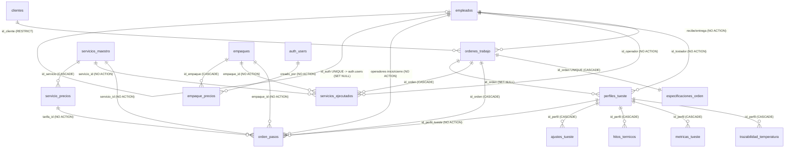
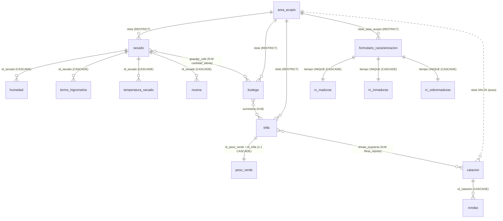

# Data Model: Integración CafeTrack ↔ CoffeeBeanFlow

**Feature**: `001-doc-arquitectura-integracion`

## ER dual (esqueleto)

### CafeTrack — 16 tablas (fuente: catálogo PostgreSQL con 24 migraciones aplicadas)

Relaciones y ON DELETE verificados vía `pg_constraint` (detalle completo en §2 del documento principal):

Nota: `auth_users` es el stub de `auth.users` (Supabase Auth). `empleados` y `empaque_precios` son las únicas tablas que referencian a Auth.

### CoffeeBeanFlow — 19 tablas (fuente: §2.1–2.20 de la spec externa)

## Pipeline unificado (esqueleto — detalle y eventos en §4.7)

1. **CBF**: acopio → caracterización → secado → bodega → trilla
2. **Handoff**: trilla con `wverde_final` → crear orden CafeTrack (via `orden_lotes_externos` K1)
3. **CafeTrack**: chancado/tueste/molido/empacado (orden_pasos, RPCs 0024)
4. **Handoff inverso**: perfil tueste `Completado` → catación CBF (via `public_id` K2 + `perfil_tueste_ref` K3)
5. **Cierre**: catación → `vendido` en CBF / factura en CafeTrack (`numero_factura` solo referencia legible, K6)

## Contratos de claves (K1–K6, detalle §4.3)

| Clave | Mecanismo | Dato que viaja |
|---|---|---|
| K1 | Tabla puente `orden_lotes_externos(id_orden, nlote, peso_kg, origen)` PK compuesta | lote físico ↔ orden |
| K2 | `public_id uuid DEFAULT gen_random_uuid() UNIQUE` en `ordenes_trabajo`, `perfiles_tueste`, `clientes` | ID estable inter-sistema |
| K3 | `perfil_tueste_ref` (uuid) en la futura tabla de catación → `perfiles_tueste.public_id` | tueste ↔ catación |
| K4 | `clientes.external_ref varchar(100)` + conciliación manual | productor CBF ↔ cliente |
| K5 | UNIQUE (`external_ref`, `origen`) en tablas receptoras | idempotencia de carga |
| K6 | `numero_factura` solo como referencia legible | factura |
